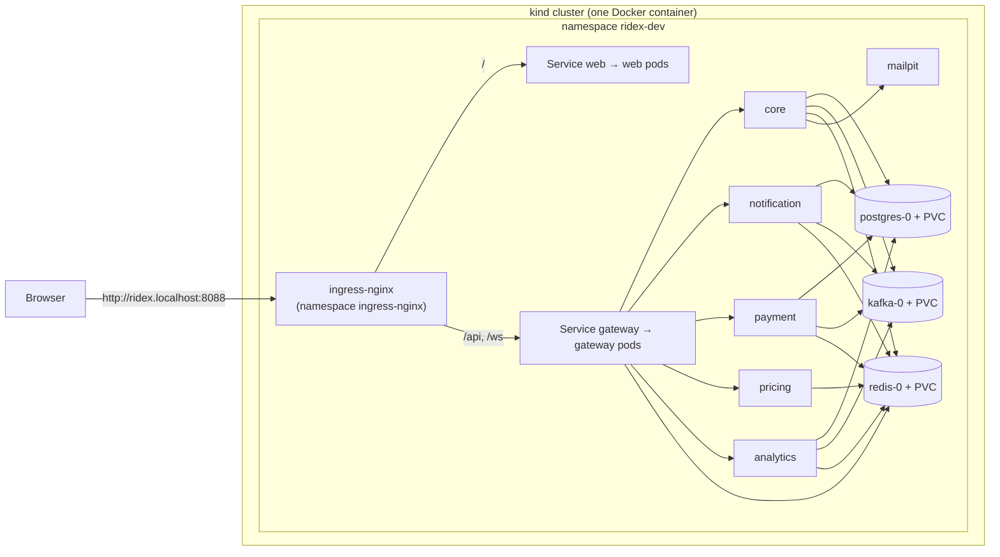

# Phase 10 review: Kubernetes

New to Kubernetes? Read [kubernetes-concepts.md](kubernetes-concepts.md) first (it follows the six steps below). This is the review: what changed, why, how to run and check it, what went wrong on the way, and how to defend it in an interview.

## 1. What changed, step by step

| Step | What we built | Where |
|---|---|---|
| 10.1 Local cluster and kubectl | A **kind** cluster (Kubernetes inside one Docker container) with a port mapping for the ingress. Scripts to create it, load the images and delete it. A `kubectl` cheat sheet | `infrastructure/k8s/kind/kind-config.yaml`, `scripts/k8s-up.ps1`, `k8s-down.ps1`, `kubernetes-concepts.md` |
| 10.2 Deployments and Services | One **Deployment** (ReplicaSet, rolling updates) and one **ClusterIP Service** per application: core, notification, payment, pricing, analytics, gateway, web | `infrastructure/k8s/base/*.yaml` |
| 10.3 ConfigMaps, Secrets, Namespaces | **ConfigMap** generated by kustomize (hash in the name: a change rolls the pods). **Secrets** mounted as files and read through Spring configtree, as in Phase 9. **Namespaces** `ridex-dev`, `ridex-staging`, `ridex-prod` with Pod Security labels, and a **kustomize base + three overlays** so one set of files serves three environments | `base/kustomization.yaml`, `overlays/*` |
| 10.4 Ingress | An **Ingress** (host `ridex.localhost`): `/api` and `/ws` to the gateway, everything else to the website; TLS in staging/prod. **Default-deny NetworkPolicies** with explicit allow rules | `base/ingress.yaml`, `base/networkpolicies.yaml` |
| 10.5 Stateful components | PostgreSQL, Redis and Kafka as **StatefulSets** with `volumeClaimTemplates` (PVCs) and headless Services. The core's data on a PVC. Written explanation of why databases are not plain pods | `base/postgres.yaml`, `redis.yaml`, `kafka.yaml`, `core.yaml` |
| 10.6 Probes and rolling updates | **Startup, liveness and readiness probes** on `/actuator/health/*` (the core gained actuator for this); `RollingUpdate` with `maxSurge: 1, maxUnavailable: 0`; `preStop` sleep, Spring **graceful shutdown**, grace period; PodDisruptionBudgets; HPA in prod | all workloads, `base/pdb.yaml`, `overlays/prod/hpa.yaml`, `application.properties` of every service |

Application changes this phase needed (small but real): `/actuator/health/liveness|readiness` on **every** service (the core had no actuator), `server.shutdown=graceful` on every service, and a permission-matrix test for the core's new public probe URLs.

## 2. The layout

```
infrastructure/k8s/
  base/                     the same in every environment
    core.yaml ... web.yaml  Deployment + Service (+ PVC for the core)
    postgres.yaml redis.yaml kafka.yaml   StatefulSet + headless Service + volumeClaimTemplates
    ingress.yaml  networkpolicies.yaml  pdb.yaml  serviceaccount.yaml
    kustomization.yaml      lists everything, generates the ConfigMap
  overlays/dev/             namespace ridex-dev, mailpit, secrets generated from git-ignored files
  overlays/staging/         namespace ridex-staging, release-candidate images, 2 replicas, TLS, real mail host
  overlays/prod/            namespace ridex-prod, versioned registry images, autoscaling, TLS, more memory
  kind/kind-config.yaml     the local cluster
```



## 3. Decisions and reasons

| Decision | Reason |
|---|---|
| **kind** for the local cluster | The cluster is one container: disposable, no virtual machine, closer to real Kubernetes than "single-node" convenience tools. `kind delete cluster` leaves nothing behind |
| **Kustomize**, not Helm | We deploy our own software to three environments: patches over a base are simpler than templates. (Helm is better for software you distribute.) |
| One base, namespaces for environments | Service names are namespace-local, so `core` means the right thing in dev, staging and prod without changing any configuration |
| Ingress routes `/api` and `/ws` straight to the gateway | The gateway learns the real client address from the ingress controller (trusted private range). Sending traffic through the website's nginx first would hide it again (see Phase 9) |
| `enableServiceLinks: false` everywhere | Service links inject `REDIS_PORT=tcp://...` which Spring cannot parse and the Kafka image mistakes for broker configuration |
| Probes report the application's own state, not its dependencies | Otherwise a database blip makes every pod unready at once: a cascading failure |
| `maxUnavailable: 0, maxSurge: 1` | Capacity never drops during an update; readiness is the gate |
| `preStop sleep 8` + graceful shutdown + 40 s grace | Closes the gap between "removed from the Service" and "stopped receiving requests" |
| No CPU limits, but memory requests and limits | Memory over the limit must kill the offender; CPU limits only throttle and add latency |
| The core is `Recreate` with 1 replica | Its disk is `ReadWriteOnce`; a rolling update could deadlock on another node. Honest limitation; the fix is design (object storage), not YAML |
| StatefulSets for PostgreSQL, Redis, Kafka, with a note that production uses managed services | Teaches the mechanism (identity, volumes, headless Services) without pretending a single pod is a production database |
| Secrets generated for dev only; staging and prod expect them from outside | A secret in git is a leak; the overlays enforce the difference and a test checks it |
| NetworkPolicies included, with a runtime check of whether they are enforced | A policy the cluster silently ignores is worse than none: it gives false comfort |
| Pod Security `enforce=baseline`, `warn=restricted` | The cluster itself refuses dangerous pods; our pods already meet most of `restricted` |

## 4. How to run it

```powershell
cd F:\RideX\ridex
# once: get kind. "winget install Kubernetes.kind" failed on the machine this was built on, so download kind-windows-amd64 from
#   https://github.com/kubernetes-sigs/kind/releases and save it as tools\kind.exe (the scripts use it from there; git ignores tools\)
cd infrastructure\docker-compose ; docker compose down ; cd ..\..      # free the memory: the cluster needs about 3 GB
.\scripts\docker-init.ps1 ; cd infrastructure\docker-compose ; docker compose build ; cd ..\..   # only if the ridex/*:dev images do not exist yet
.\scripts\k8s-init.ps1          # once: creates the dev secret files
.\scripts\k8s-up.ps1            # cluster, images, ingress controller, RideX (first time: pulls about 1 GB)
.\scripts\k8s-smoke.ps1         # checks; add -Chaos to break things on purpose
```
Open **http://ridex.localhost:8088**. When done: `.\scripts\k8s-down.ps1` (deletes the cluster and its volumes).

Offline checks (no cluster needed):
```powershell
kubectl kustomize infrastructure\k8s\overlays\prod      # the final YAML of production
cd backend ; .\mvnw.cmd -pl architecture-tests test -Dtest=KubernetesPolicyTest
```

### Things to try (this is the learning part)
```powershell
kubectl get pods -n ridex-dev                         # what is running
kubectl get all -n ridex-dev                          # Deployments, ReplicaSets, Pods, Services
kubectl describe pod -n ridex-dev -l app.kubernetes.io/name=pricing    # read the Events at the bottom
kubectl logs -n ridex-dev deploy/gateway --tail=20
kubectl get pvc -n ridex-dev                          # the disks
kubectl delete pod -n ridex-dev -l app.kubernetes.io/name=pricing      # kill it, watch another appear
kubectl scale deployment/pricing -n ridex-dev --replicas=3             # three copies behind one Service
kubectl rollout restart deployment/pricing -n ridex-dev                # a rolling update; in another window: kubectl get pods -w -n ridex-dev
kubectl rollout history deployment/pricing -n ridex-dev ; kubectl rollout undo deployment/pricing -n ridex-dev
kubectl port-forward -n ridex-dev svc/mailpit 8025:8025                # then open http://localhost:8025 (the mail inbox)
kubectl exec -n ridex-dev -it postgres-0 -- psql -U ridex -d ridex_db -c "\dt"
```

### Troubleshooting
| Symptom | Cause and what to do |
|---|---|
| Pod `Pending` | Not enough memory on the node, or a PVC not bound. `kubectl describe pod` → Events says which |
| Pod `ErrImageNeverPull` / `ImagePullBackOff` | The image is not inside the cluster. `.\scripts\k8s-up.ps1` loads them (`kind load docker-image`); a kind node cannot see your machine's Docker images until you load them |
| `CrashLoopBackOff` | The container starts and dies. `kubectl logs <pod> --previous` |
| Pods keep restarting with `OOMKilled` | The memory limit is too small for the machine load; raise Docker's memory or the limit |
| Pod `Running` but not `Ready` | The readiness probe fails: the application is still starting, or really unhealthy. `kubectl describe pod` shows the probe failures |
| `http://ridex.localhost:8088` does not answer | The ingress controller is not ready: `kubectl get pods -n ingress-nginx`; or the port 8088 is used by something else |
| 503 from the ingress | The Service has no ready pods behind it: `kubectl get endpoints -n ridex-dev` |

## 5. What was verified on a real cluster

Everything below was run for real on this laptop: kind v0.33.0, Kubernetes **v1.34.11**, one node, default `standard` StorageClass (rancher local-path), ingress-nginx v1.14.0.

| Claim | Evidence |
|---|---|
| All 11 workloads become ready | `k8s-smoke.ps1`: every Deployment and StatefulSet shows `1/1` |
| Traffic works end to end | login, notifications, fares, admin 403s, a ride request (core calls pricing **by Service name** with the secret token), WebSocket handshake **101**, all through the ingress on port 8088 |
| Secrets are files, not environment | password absent from the pod specification; `/run/secrets` present; no Kubernetes API token mounted into the pod |
| Pods are hardened | runs as a normal user; read-only root filesystem rejects a write |
| Service links off | `REDIS_PORT` is not a `tcp://` address inside the pod |
| Disks are real | four PVCs (core 1 Gi, kafka 2 Gi, postgres 2 Gi, redis 512 Mi) are `Bound` |
| **Self-healing** | deleting a pricing pod: the ReplicaSet created a new pod with a new name, it became ready, fares worked again |
| **Zero-downtime rolling update** | pricing scaled to 2, every pod replaced one by one while one request was sent every 200 ms: **603 requests, 0 failed** |
| **A broken release is contained** | an image that does not exist: the new pod sat in `ErrImagePull`, the **old pod kept serving**, `kubectl rollout undo` restored the working version |
| **The database survives its pod** | `postgres-0` deleted: it came back with the same name and **the registered user still existed** (data on the PersistentVolume) |
| The offline policy tests | 23 Kubernetes tests, and the Docker ones, run in the normal build |

Final smoke test: **ALL CHECKS PASSED** (including `-Chaos`).

### Honest findings (these are the lessons, read them)
1. **NetworkPolicies are not enforced on this cluster.** The test pod could reach the database. kind's default network plugin does not implement them, so the 10 policies here are documentation until the cluster runs Calico or Cilium. A policy the cluster ignores is worse than none because it creates false confidence: this is why the smoke test checks.
2. **Single replica means a gap.** Deleting the only pricing pod leaves a few seconds with no ready pod. Two replicas (and the rolling update) have no gap at all, which the 603-request test proves.
3. **No startup ordering.** The notification, payment and analytics services restarted a few times at first start because PostgreSQL and Kafka were not ready yet; Kubernetes just restarted them until they were. Compose's `depends_on` has no equivalent: the application must tolerate a late dependency.

## 6. Things that went wrong on the way (and what they teach)

1. **The first cluster would not start (Kubernetes 1.37).** Docker Desktop's Linux VM here uses *cgroup v1*; Kubernetes 1.35 and later refuse to run on it. The kind config now pins `kindest/node:v1.34.11`, the newest that works, with a comment explaining why. (Check yours: `docker info --format "{{.CgroupVersion}}"`.)
2. **`kind load docker-image` failed for postgres, redis, kafka and mailpit** ("content digest not found"): a Docker image-store quirk with multi-platform images. Fix: do not load public images; the cluster pulls them itself.
3. **The Ingress was rejected on the first apply.** ingress-nginx checks Ingress objects through an admission webhook that is reachable a few seconds *after* its pod is ready. The script now retries the apply.
4. **mailpit crash-looped** with "read-only file system". We made every pod's root filesystem read-only (good), and mailpit writes its mailbox to `/tmp`. Fix: an `emptyDir` volume. The hardening has a price: every writable path must be declared.
5. **The core never became ready: probes returned 401.** The `ridex/core:dev` image was built in Phase 9, *before* this phase added the actuator endpoints. Kubernetes did exactly the right thing (it kept the pod out of service and restarted it). Lesson: an image is a snapshot; rebuild after code changes, and tag images so you can tell which is which. Locally every build is `:dev`; real pipelines tag with the commit or version.
6. **The API server started timing out ("TLS handshake timeout")** while all pods restarted at once on a node with little free memory: the control plane shares the machine with the workloads. On one small node, restart deployments one at a time.
7. **Small script bugs worth knowing about:** Windows PowerShell 5.1 turns a native command's stderr output into an error under `$ErrorActionPreference = 'Stop'`, and mangles quotes inside a `jsonpath` argument. The scripts avoid both.

## 7. What was and was not verified

| | Status |
|---|---|
| Base and dev overlay | **Applied to a real cluster and exercised** (above) |
| Staging and prod overlays | Rendered with `kubectl kustomize` and policy-tested; **never applied** (they need a registry, real hosts, TLS and secrets) |
| Ingress TLS and cert-manager | Configured, not testable locally |
| HorizontalPodAutoscaler | Written, not testable (needs metrics-server and load) |
| PodDisruptionBudgets | Created; no node drain was performed (one node) |
| NetworkPolicies | Created; **not enforced** by this cluster (see finding 1) |
| Pod Security `restricted` warnings | Enforced at `baseline`; see the warnings printed by `kubectl apply` for anything short of `restricted` |


## 8. Interview questions and answers

**1. What problem does Kubernetes solve that Docker Compose does not?**
Compose runs containers on one machine. Kubernetes runs them across many, keeps them in the declared state (replaces failed pods, reschedules when a node dies), provides service discovery and load balancing, updates without downtime, scales, and separates configuration and secrets from images.

**2. What is "desired state" and a controller?**
You declare what you want (3 replicas of image X). Controllers run loops that compare reality with that declaration and act on the difference, continuously. That is why deleting a pod just causes another to be created.

**3. Pod, ReplicaSet, Deployment: how do they relate?**
A pod is one or more containers sharing a network address, and is disposable. A ReplicaSet keeps N identical pods. A Deployment manages ReplicaSets across versions: an update creates a new ReplicaSet and moves pods over, keeping the old one for rollback.

**4. How do pods find each other when their IPs keep changing?**
Through Services: a stable virtual IP and DNS name that load-balances over the ready pods selected by labels. Inside the namespace, `pricing` resolves to the Service.

**5. ConfigMap versus Secret?**
ConfigMaps hold non-secret settings; Secrets hold sensitive values. A Secret is base64-encoded, not encrypted, so it still needs RBAC, encryption at rest, and must not be committed to git. We mount secrets as files and keep staging/prod secrets outside the repository.

**6. How do you run the same application in dev, staging and prod?**
One image, different configuration. Namespaces separate the environments; kustomize overlays (or Helm values) patch what differs: replicas, host names, mail host, image tags. Because Service names are namespace-local, internal addresses do not change.

**7. Ingress versus Service type LoadBalancer?**
A LoadBalancer Service exposes one Service per external IP. An Ingress is a set of HTTP routing rules (host and path) served by one controller and one external address; it also terminates TLS. The controller (ingress-nginx, Traefik) must be installed; the Ingress object alone does nothing.

**8. Why are databases StatefulSets, and why still not plain pods in production?**
A StatefulSet gives stable pod names and DNS, one persistent volume per pod, and ordered start/stop. It does not give backups, replication, failover or safe upgrades. Production uses a managed database or an operator that implements those.

**9. PV, PVC and StorageClass?**
A PVC is the application's request for storage; a PV is the actual disk; a StorageClass says how to create PVs on demand. Pods only reference the claim, so the same manifest works on any cluster.

**10. Liveness versus readiness versus startup probes?**
Startup: is it finished starting (others wait for it). Liveness: is it stuck, so restart it. Readiness: can it serve now; if not, remove it from the Service without restarting. Liveness must not depend on external systems, or an outage of a dependency restarts everything.

**11. How does a rolling update avoid downtime?**
It starts a new pod (surge), waits until its readiness probe passes, then removes an old one, with `maxUnavailable: 0` so capacity never drops. Combined with a `preStop` delay and graceful shutdown, in-flight requests finish. A broken version never becomes ready, so the update stalls and the old version keeps serving; `rollout undo` reverts.

**12. What are requests and limits?**
The request is what the scheduler reserves and uses to place the pod; the limit is the ceiling. Exceeding the memory limit gets the container killed (OOMKilled); exceeding a CPU limit only throttles it, so many teams set no CPU limit.

**13. Why did you set `enableServiceLinks: false`?**
By default Kubernetes injects environment variables for every Service (`REDIS_PORT=tcp://10.0.0.5:6379`). Spring reads `REDIS_PORT` as a port number and the Kafka image reads every `KAFKA_*` variable as configuration; both break.

**14. What does a NetworkPolicy do, and what is the catch?**
It restricts which pods may connect to which (default deny, then allow rules). It is enforced by the network plugin (CNI); if the plugin does not support it, the policies are silently ignored, so you must test enforcement.

**15. Why is the core a single replica with `Recreate`?**
It keeps uploads and the signing key on a ReadWriteOnce volume, which one node can mount at a time, so two copies cannot run during a rolling update on different nodes and cannot scale. The fix is architectural: object storage for documents and a Secret for the key, which makes it stateless.

**16. How would you deploy a new version of one service?**
CI builds and tests the image, pushes it with a version tag; the overlay's `images:` entry changes the tag; `kubectl apply -k` (or a GitOps tool) updates the Deployment; Kubernetes rolls it out gradually; `rollout status` confirms; `rollout undo` if it misbehaves.

## 9. What is still simplified

* One node: no real scheduling choices, no node failure, no anti-affinity or topology spread.
* kind's default network plugin may not enforce NetworkPolicies (the smoke test reports whether it does).
* Single-pod PostgreSQL, Redis and Kafka; production needs managed services or operators, and backups.
* Images are loaded into the node by hand; a real cluster pulls from a registry (CI/CD phase).
* The ingress controller is plain HTTP locally; TLS (cert-manager) is configured for staging and prod but cannot be tested locally.
* The horizontal autoscaler needs the metrics-server add-on, which is not installed locally.
* No GitOps tool (Argo CD, Flux) and no monitoring yet; both belong to later phases.
* Staging and prod overlays are rendered and policy-tested but were never applied to a real cluster (see section 7).

## 10. Test results of the whole build

`cd backend; .\mvnw.cmd install` (run with the cluster paused, because the tests start their own PostgreSQL, Redis and Kafka):

| Module | Tests |
|---|---|
| platform | 23 |
| core | 428 |
| notification-service | 21 |
| payment-service | 19 |
| pricing-service | 19 |
| analytics-service | 7 |
| api-gateway | 37 |
| architecture-tests (boundaries, databases, containers, **Kubernetes**) | 60 |
| **Backend total** | **614** |

One honest note: in the first full run `CachingIntegrationTest.theSecondReadComesFromRedisAsPlainJson` failed once ("expected the cache key to exist"). It passes when run alone and passed in the second full run (428 of 428). It shares one Redis with many other test classes, so a timing interaction is the likely cause; it is worth hardening (wait for the key instead of reading it immediately) but nothing in this phase changes caching.

The Kubernetes smoke test (`.\scripts\k8s-smoke.ps1 -Chaos`) passes against the live cluster.
