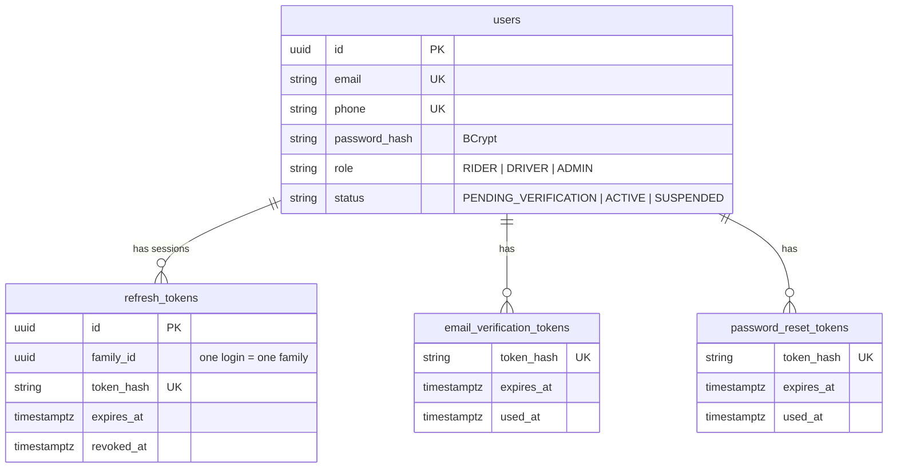
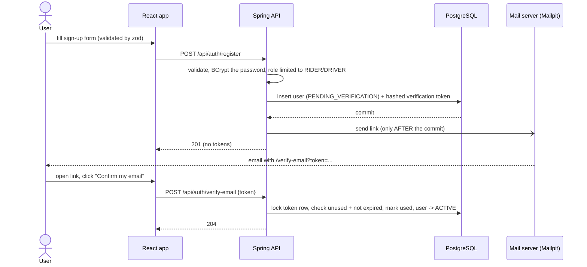
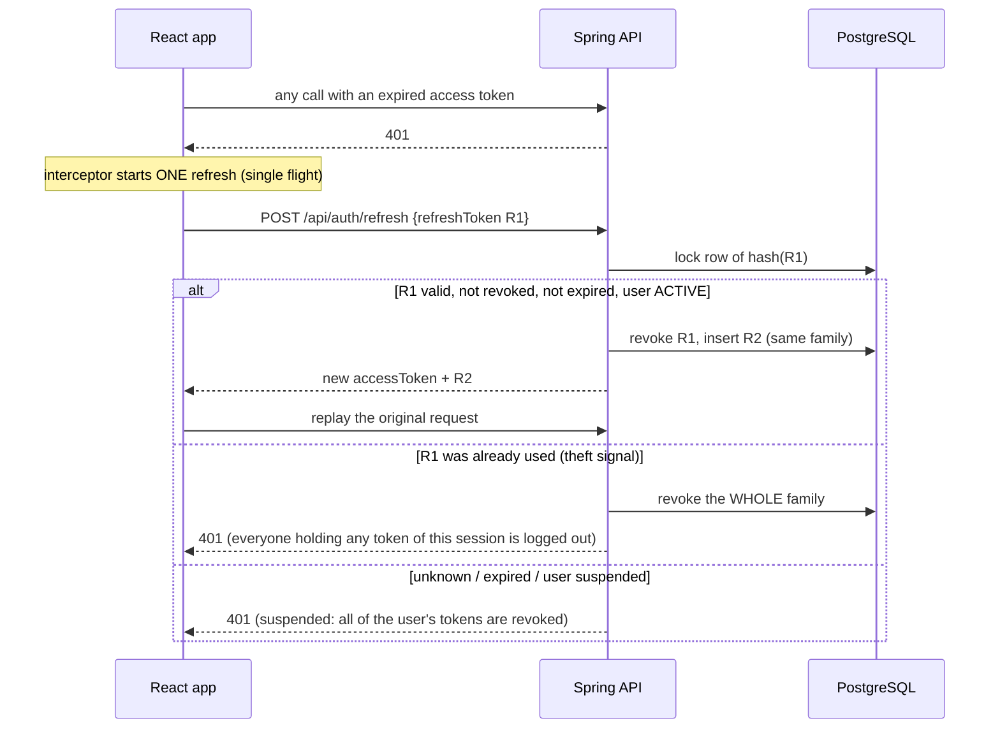
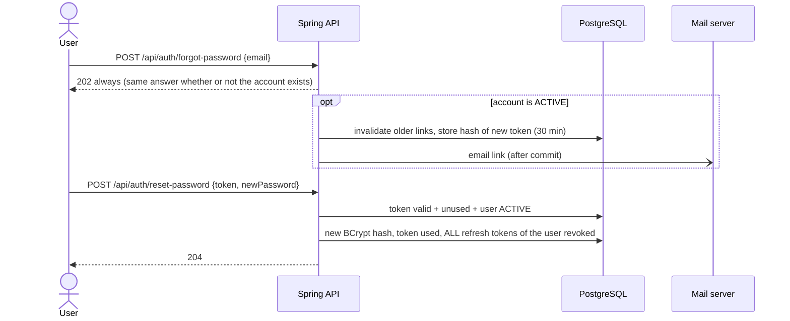
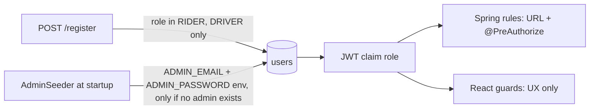

# Phase 2 review: authentication

Scope: everything between "a stranger arrives" and "a known user with a role may call the API".
Status at the end of Phase 2: 77 backend tests and 27 frontend tests pass; the full flow was checked
in a browser (landing, validation, login, role-based shell).

Diagrams use Mermaid (GitHub renders them). Endpoint details are in [api-auth.md](api-auth.md); the
generated, always-current contract is Swagger UI at `/swagger-ui.html`.

---------------------------------------------------------------------------------------------------
## 1. What was built

| Step | Capability | Main classes |
|---|---|---|
| 2.1 | `users` table, entity, repository | `User`, `UserRepository`, `V2` |
| 2.2 | Registration, validation, BCrypt, error format | `AuthService.register`, `GlobalExceptionHandler` |
| 2.3 | Stateless Spring Security, deny by default, JSON 401/403 | `SecurityConfig` |
| 2.4 | Login + JWT access token (HS256, 15 min) | `JwtService`, `JwtConfig` |
| 2.5 | JWT filter, roles, `/api/users/me` | `JwtAuthenticationFilter`, `AuthenticatedUser` |
| 2.6 | Refresh tokens: rotation, reuse detection, logout | `RefreshTokenService`, `V3` |
| 2.7 | Email verification (link) via SMTP (Mailpit) | `EmailVerificationService`, `SmtpEmailSender`, `V4` |
| 2.8 | Forgot / reset password | `PasswordResetService`, `V5` |
| 2.9 | First admin seeded from environment | `AdminSeeder` |
| 2.10 | React auth screens, guards, auto-refresh | `api/session.ts`, `auth/*` |
| UI | Design system, landing, restyled auth | `features/*`, `components/ui` |

Data model (all keys are UUIDs; all tokens stored as SHA-256 hashes):



---------------------------------------------------------------------------------------------------
## 2. Flows

### 2.1 Register and verify email

Why a click and a POST: mail scanners open links automatically; a plain page load must not change data.

### 2.2 Login and an authenticated request
```mermaid
sequenceDiagram
    participant W as React app
    participant F as JwtAuthenticationFilter
    participant S as Authorization rules
    participant C as Controller
    participant DB as PostgreSQL

    W->>C: POST /api/auth/login {email, password}
    C->>DB: find user (always one BCrypt compare, even if unknown)
    C->>DB: store refresh token (hash only, new family)
    C-->>W: accessToken (15 min, in memory) + refreshToken (7 days)

    W->>F: GET /api/users/me  Authorization: Bearer <accessToken>
    F->>F: verify signature, expiry, issuer; read sub + role
    F->>S: SecurityContext = (userId, ROLE_x) or stay anonymous
    S-->>W: 401 if anonymous on a protected URL, 403 if the role is wrong
    S->>C: allowed
    C->>DB: /me reloads the user: status is read from the database, not the token
    C-->>W: 200 profile
```

### 2.3 Refresh with rotation and reuse detection


### 2.4 Forgot and reset password


### 2.5 Where each role comes from


---------------------------------------------------------------------------------------------------
## 3. Security checklist

Legend: **OK** implemented and covered by a test or a manual check. **GAP** known, deliberately deferred, with the phase that closes it.

### Passwords and accounts
| Check | Status | Notes |
|---|---|---|
| Passwords hashed with a slow, salted hash | OK | BCrypt (default cost) |
| Policy: 8-72 characters, a letter and a digit | OK | Same rules in zod and Bean Validation |
| Login does not reveal whether an email exists | OK | One message; a dummy BCrypt compare equalises timing |
| Account state shown only after a correct password | OK | "verify your email" / "suspended" come after the password check |
| Admin accounts cannot be created through the API | OK | Role enum has no ADMIN; the seeder only runs once and never promotes an account |
| Brute-force protection (rate limit, lockout) | **GAP** | Phase 4.7 (Redis counters) |
| 72-character limit is really a 72-byte limit in BCrypt | **GAP** | Multi-byte characters can exceed it; validate bytes |
| Registration reveals "email already registered" (409) | **GAP** | Accepted UX trade-off for now; rate limiting reduces abuse |
| MFA, email-change flow, audit log of security events | **GAP** | Phase 14 |

### Tokens
| Check | Status | Notes |
|---|---|---|
| Access token short-lived | OK | 15 minutes |
| Algorithm pinned, secret from environment, length checked | OK | HS256; startup fails if the secret is under 32 bytes |
| Signature, expiry **and issuer** validated | OK | Issuer check added in this review (`JwtConfigTest`) |
| Forged tokens rejected | OK | `JwtAuthenticationFilterTest` signs with a different key |
| Refresh token: random, only its hash stored, rotated on use | OK | 256-bit random, SHA-256 |
| Reuse of a rotated token revokes the whole session | OK | `RefreshTokenServiceTest` |
| Concurrent refreshes cannot both succeed | OK | Row lock server-side; single-flight client-side (`session.test.ts`) |
| Verification / reset tokens: hashed, single-use, expiring, older ones invalidated | OK | 15 / 30 minutes |
| Reset ends every other session | OK | Revokes all refresh tokens |
| Access token still works after suspend / role change until it expires | **GAP** | Up to 15 minutes. `/me` and refresh re-check the database. Phase 4.8 adds revocation |
| Expired / used token rows are never purged | **GAP** | Tables grow; add a scheduled cleanup |
| HS256 shares one secret between signer and verifier | **GAP** | Fine for one app; move to asymmetric keys when services split (Phase 7-8) |

### Authorization
| Check | Status | Notes |
|---|---|---|
| Deny by default | OK | Only `/api/auth/**`, `/api/health` and the API docs are public |
| URL rules and `@PreAuthorize` together | OK | Matrix tested in `SecurityRulesIntegrationTest` |
| "Who am I" comes from the token, never the URL or body | OK | `@AuthenticationPrincipal` |
| 401 vs 403 used correctly, JSON bodies | OK | Same `ApiError` shape everywhere |
| Frontend role checks are only UX | OK | Backend re-checks every call; `RouteGuards.test.tsx` documents the UX behaviour |

### Web and transport
| Check | Status | Notes |
|---|---|---|
| CSRF | OK (disabled on purpose) | Stateless, token in the `Authorization` header, no cookies |
| CORS | OK (none) | The browser talks to one origin (Vite proxy now, gateway later). The earlier comment about a CORS config was wrong and is fixed |
| Security headers | OK | Spring Security defaults. Observed on a real response: `X-Frame-Options: DENY` and `Expires: 0` (cache disabled); the defaults also include `X-Content-Type-Options: nosniff`. Re-check with `curl -i` after any security change |
| HTTPS / HSTS | **GAP** | TLS terminates at the edge: ingress/gateway (Phases 8-10) |
| API docs exposed | **GAP** | On in dev. Set `springdoc.api-docs.enabled=false` and `springdoc.swagger-ui.enabled=false` in production |
| Public endpoints can be hammered (register, forgot-password) | **GAP** | Phase 4.7 |

### Data and secrets
| Check | Status | Notes |
|---|---|---|
| No secrets in the repository | OK | `DB_PASSWORD`, `JWT_SECRET`, `ADMIN_*` come from environment variables; `.env` is git-ignored |
| Tokens and passwords never logged | OK | The filter logs only an exception class name; reuse logs only ids |
| Errors do not leak internals | OK | Unexpected errors return a generic 500; details stay in the server log |
| Emails appear in failure logs | **GAP** (minor) | Fine in dev; mask them for production logging (Phase 12.1) |
| Mail sent only after the transaction commits | OK | `AFTER_COMMIT` listener |
| Sending mail inside the request is a timing side channel | **GAP** | Makes "account exists" slightly slower. Fix with async send / Kafka (Phase 6) |

### Frontend
| Check | Status | Notes |
|---|---|---|
| Access token only in memory | OK | Lost on reload, recovered by refresh |
| Refresh token in `localStorage` | **GAP** | Readable by any XSS bug. Production alternative: `HttpOnly` + `Secure` + `SameSite` cookie set by the backend (needs backend and CSRF work) |
| Server messages rendered as text | OK | React escapes; no `dangerouslySetInnerHTML` |
| One refresh at a time (StrictMode and parallel 401s) | OK | Tested |
| Two browser tabs refreshing at the very same moment can log each other out | **GAP** | Web Locks API would serialise them |

---------------------------------------------------------------------------------------------------
## 4. Changes made during this review
1. JWT decoder now validates the **issuer** as well as signature and expiry (`JwtConfig`, `JwtConfigTest`).
2. Removed a misleading comment claiming a `CorsConfig` existed (`SecurityConfig`). CORS is intentionally not configured.
3. Added frontend tests for the single-flight refresh, route guards and validation schemas (27 tests).

---------------------------------------------------------------------------------------------------
## 5. Interview questions and model answers

**1. JWT or server sessions?**
JWTs are stateless, so any instance can verify them with no shared store, which suits horizontal scaling.
The price is revocation: a token is valid until it expires. We keep access tokens at 15 minutes and keep
state only for refresh tokens, which is where revocation matters.

**2. Walk through what happens on an authenticated request.**
The filter reads the Bearer header, verifies signature, expiry and issuer, and puts `(userId, ROLE_x)` in the
`SecurityContext`. It never rejects: unauthenticated requests stay anonymous. The authorization rules then
answer 401 (anonymous on a protected URL) or 403 (wrong role). Method security can still say 403 in the controller.

**3. Why is `ROLE_` needed?**
`hasRole("ADMIN")` adds the prefix itself, so the authority must be `ROLE_ADMIN`. Forgetting it is the classic
"hasRole never works" bug.

**4. 401 versus 403?**
401: I do not know who you are. 403: I know you, and the answer is no.

**5. Why not store refresh tokens in plain text?**
A database leak would hand out live sessions. We store a SHA-256 of a 256-bit random token. A fast hash is fine
here (unlike passwords) because the input is unguessable, and we need a deterministic value to look it up.

**6. What is refresh-token rotation and why detect reuse?**
Every refresh issues a new token and kills the old one. If an old token shows up again, either the user or an
attacker has a stale copy, so we cannot tell who is who and revoke the whole family. That limits the damage of
a stolen token to one refresh cycle.

**7. Two tabs, or React StrictMode, call refresh at once. What goes wrong and how do you prevent it?**
Both send the same token; the second looks like reuse and logs everyone out. Client side we share one in-flight
promise (single flight). Server side a row lock serialises concurrent requests.

**8. A user is suspended or demoted. What can they still do?**
Anything their access token allows for up to 15 minutes, because the filter trusts only the token. Refresh and
`/me` re-read the database, so the window ends at the next refresh. Closing it fully needs a revocation list in
Redis (Phase 4.8).

**9. How do you avoid revealing which emails are registered?**
Login returns one message and does a dummy BCrypt compare so timing matches. Forgot-password and
resend-verification always return 202. Registration still says "already registered", a known trade-off we mitigate
with rate limiting later.

**10. Why is CSRF disabled? Is that safe?**
CSRF abuses cookies the browser attaches automatically. We use a bearer header set by our own JavaScript, so a
forged cross-site request carries no credential. It would stop being safe if we moved tokens into cookies.

**11. Why send the email after the commit?**
If the transaction rolls back after the email left, the user holds a link for an account that does not exist. An
`AFTER_COMMIT` listener sends only for committed data. The remaining risk (commit succeeds, send fails) is
handled by "resend"; a transactional outbox closes it properly (Phase 6).

**12. Why do verification and reset use POST from a button, not a GET link?**
Mail scanners and link previews fetch URLs automatically. A GET that changes state would verify accounts or burn
tokens without the user.

**13. Where would the refresh token live in production, and why not `localStorage`?**
An `HttpOnly`, `Secure`, `SameSite` cookie: JavaScript cannot read it, so XSS cannot steal it. The cost is CSRF
protection on the refresh endpoint. We documented `localStorage` as a conscious simplification.

**14. How is the first admin created safely?**
From environment variables at startup, only when no admin exists, refusing to promote an existing account, and
failing startup on a weak password. Public registration cannot produce an ADMIN because the role enum excludes it.

**15. Why validate on the client and the server?**
Client validation is for speed and usability; the server is the authority because anyone can bypass the UI.
We keep the rules identical and map the server's field errors back onto the form.

**16. What are the weaknesses of this design today?**
No rate limiting, a 15-minute stale-claims window, refresh token in `localStorage`, expired token rows never
purged, a shared HMAC secret. Each has a named phase in the roadmap.

---------------------------------------------------------------------------------------------------
## 6. Carry-over to later phases
| Item | Phase |
|---|---|
| Rate limiting, brute-force protection | 4.7 |
| Access-token revocation (suspended users, logout) | 4.8 |
| OTP and tokens in Redis with TTL (removes the purge job) | 4.2 |
| Async email / events | 6.6 |
| Asymmetric JWT keys, gateway validation | 8.2 |
| Structured, masked logging | 12.1 |
| HttpOnly refresh cookie (hardening pass) | before production |
