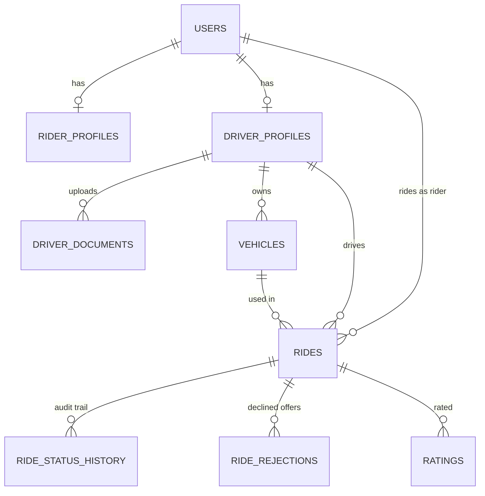
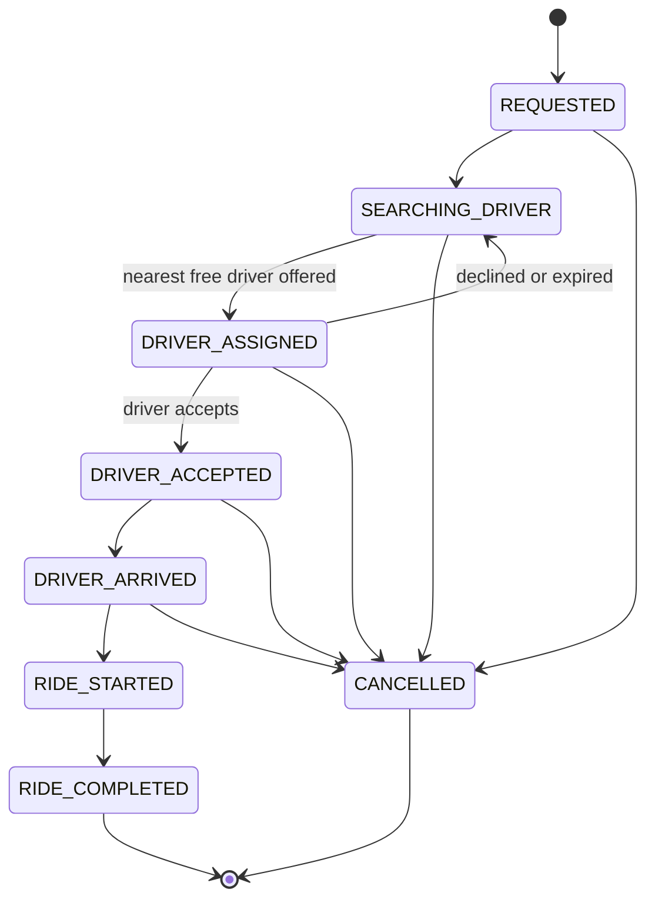

# Phase 3 review: the core ride system

> **Updated in Phase 4:** driver positions and the "who is nearby" search moved to Redis (see [phase-4-review.md](phase-4-review.md)). The PostgreSQL row lock and unique indexes described here are still the final authority.

This document explains what Phase 3 added, why each decision was made, and how to defend it
in an interview. Every claim below is backed by a test or a measurement in this repository.

## 1. What a rider and a driver can now do

| Who | Can do | Where |
|---|---|---|
| Driver | Upload licence / RC / insurance / ID, add vehicles, choose the active one, go online and share location, accept or decline offers, mark arrived / start / complete, cancel | `driver/`, `ride/` |
| Admin | Review driver applications (approve / reject with a reason), open uploaded documents, search and suspend users, see vehicles and all rides, see live numbers | `admin/`, `driver/Admin*` |
| Rider | See a price per vehicle type before booking, request a ride, follow it live, cancel, rate the driver | `pricing/`, `ride/`, `rating/` |
| Both | Rate each other once per completed trip; see paginated history | `rating/`, `ride/` |

## 2. Entity relationship diagram

## 3. Ride state machine

There is exactly one table of allowed moves (`RideStatus.ALLOWED`) and exactly one method that
changes a status (`Ride.moveTo`). Nothing else can set the status, so an illegal jump (for
example completing a ride that was never started) is impossible by construction. `RideStatusTest`
checks all 64 pairs of statuses against the diagram.

## 4. Decisions and the reason for each

| Decision | Why |
|---|---|
| Modular monolith, one package per concept | One deployable unit is simple to run; packages keep boundaries so a module can be split out later. |
| Business rules inside entities (`moveTo`, `approve`, `reject`) | A rule written once in the entity cannot be bypassed by a new controller. |
| Rules also enforced by the database (partial unique indexes) | Code can have bugs and races; the database is the last line. One active ride per rider, one per driver and one active vehicle per driver are constraints, tested by attacking them directly. |
| Matching with `SELECT ... FOR UPDATE SKIP LOCKED` | Two simultaneous requests must not receive the same driver. Locked rows are skipped, not waited on. A concurrency test proves it, and a mutation check showed the test fails when `SKIP LOCKED` is removed. |
| Offers expire (default 30 s) and rotate to the next driver | A driver who ignores the phone must not block a rider. A scheduler re-dispatches. |
| `@Version` optimistic locking on rides and drivers | Two actors changing the same ride at once: one wins, the other gets 409 instead of silently overwriting. |
| Money as `BigDecimal`, rounded `HALF_UP`, INR only | Floating point cannot represent currency exactly. |
| Fare = base + distance + time, minimum fare, tax | Shown as a breakdown so the total is never a mystery. Rates live in `application.properties`, not code. |
| Haversine distance behind a `DistanceEstimator` interface | Works with no external service now; a routing API can replace it without touching pricing. |
| Documents: magic-byte detection, random file names, size cap, attachment download | A file's extension and declared type are attacker-controlled. We look at the real bytes, never use the client's file name on disk, and never serve it inline. |
| Role rules in URL rules *and* `@PreAuthorize` | Method security runs after request-body validation, so a wrong role could get a 400 instead of 403. The permission-matrix test found this and the URL rules fixed it. |
| Pagination envelope with a clamped page size | Clients cannot ask for 10 million rows. |
| `@EntityGraph` on list queries | Removes the N+1 query problem. A test counts SQL statements: a page of rides costs at most 3, the naive version at least 16. |
| Polling (every 4 s) in the UI | Honest and simple until WebSockets arrive in Phase 5. It pauses in a hidden tab and never overlaps requests. |
| MapLibre with free CARTO tiles | No API key to leak or pay for. The map code is a separate lazy chunk, so the landing page stays small. |

## 5. Database performance (measured, 200,040 rides)

Details are in [`ride-history-explain.md`](ride-history-explain.md).

* Rider history with the composite index `(rider_id, requested_at DESC)`: **0.032 ms, 19 pages**; without it **15.5 ms, 5,985 pages**.
* Partial indexes (only active rows) are about 16 kB, a full index about 8-10 MB.
* Page 100,000 with `OFFSET`: 55.9 ms; with a keyset (seek) query: 0.056 ms. We use `OFFSET` for the admin tables (small, jumpable) and note keyset as the upgrade for very deep pages.

## 6. Testing

* Everything runs against a **real PostgreSQL 17 in Testcontainers**, not an in-memory fake, because partial indexes, `SKIP LOCKED` and constraints behave differently elsewhere.
* A parameterised **permission matrix** calls every endpoint as every role and as anonymous.
* Concurrency tests use a start gate (latch) so threads really collide.
* Frontend: Vitest for the pure rules (status rules, formatting, vehicle form validation).

## 7. Interview questions

**How do you stop two riders getting the same driver?**
The matching query locks the chosen driver row with `FOR UPDATE SKIP LOCKED`. A second transaction skips locked drivers and takes the next one. A partial unique index on `rides(driver_profile_id)` for active statuses is the safety net if code ever gets it wrong.

**Why a state machine in the entity and not in the controller?**
One place defines legal moves, so no endpoint can skip a step. It is trivially unit-testable without Spring or a database.

**What is the N+1 problem and how did you fix it?**
Loading 20 rides and then lazily loading each rider and driver costs 1 + 20 + 20 queries. `@EntityGraph` fetches them in the same query. Proven with Hibernate statistics in a test.

**Optimistic vs pessimistic locking?**
Optimistic (`@Version`) for ordinary edits where conflicts are rare: no lock held, a conflict returns 409. Pessimistic (`FOR UPDATE`) only where a conflict is expected and must be serialised: assigning a driver.

**Why not trust the uploaded file's extension?**
It is user input. We read the first bytes (PDF, JPEG, PNG signatures), store under a random name, and send it back as an attachment so the browser never runs it.

**Why is the price calculated on the server?**
The client could send any number. The server recomputes from the coordinates when the ride is requested and stores the result with the ride, so later rate changes do not alter past trips.

**Why do the admin endpoints return 404 for someone else's ride and not 403?**
A 403 confirms the ride exists. 404 leaks nothing.

**How would this scale?**
Matching is already a single indexed query. Next steps: Redis geo-index for driver positions, WebSockets for live updates (Phase 5), keyset pagination for deep history, and partitioning the rides table by month.

## 8. Known limits (honest list)

* Distance is a straight line, not road distance, so fares are estimates. The `DistanceEstimator` seam is where a routing service plugs in.
* Payment is cash only; online payment is Phase 6.
* The UI polls instead of using push; notifications are Phase 5.
* Document files are stored on local disk (`data/`); object storage comes with deployment.
