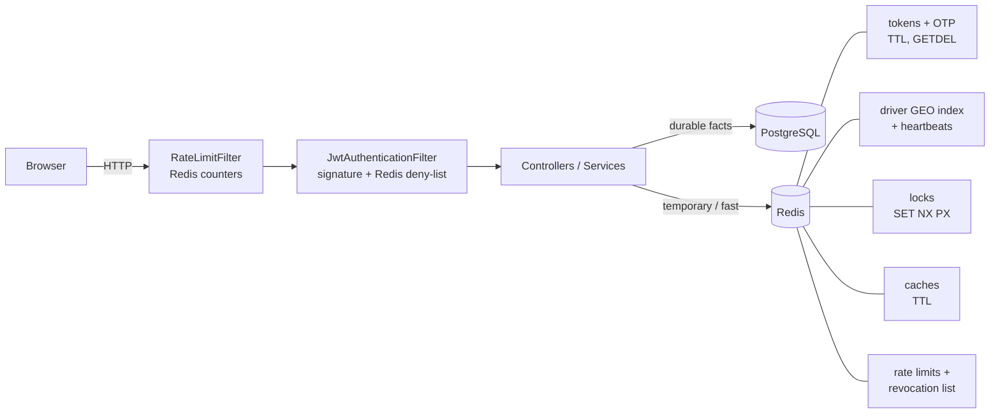
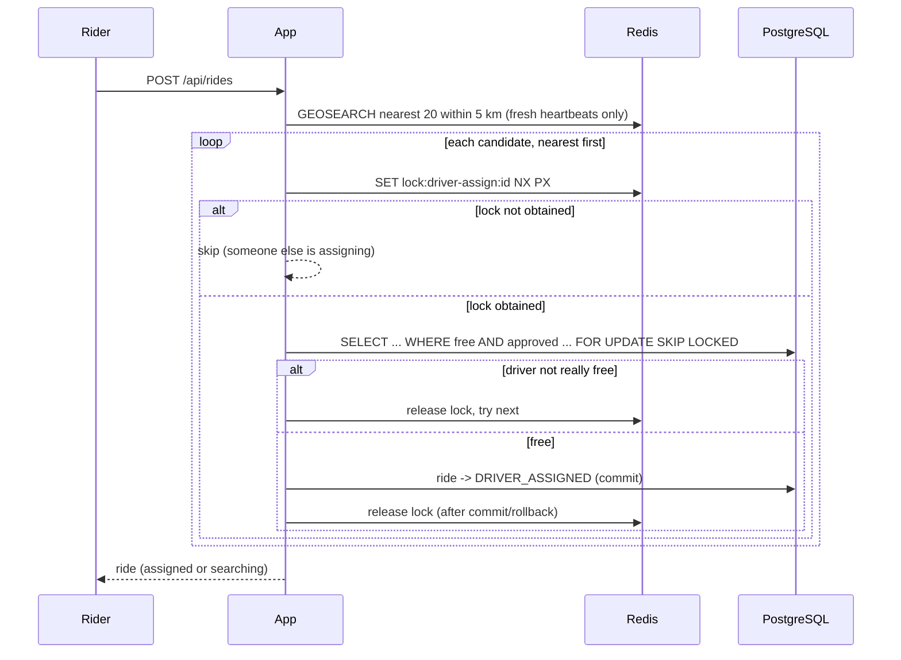

# Phase 4 review: Redis

Read [redis-concepts.md](redis-concepts.md) first if Redis is new to you. This document is the review:
what changed, why, how it is proven, and how to defend it in an interview.

## 1. What changed, step by step

| Step | What we built | Where |
|---|---|---|
| 4.1 | Redis 7 in Docker Compose (with a memory policy), Spring Data Redis, key naming in one file | `infrastructure/docker-compose`, `redis/RedisKeys` |
| 4.2 | Verification and reset tokens moved from PostgreSQL to Redis (TTL, atomic `GETDEL`); new 6-digit OTP with attempt limit; migration V11 drops the old tables | `auth/EmailVerificationService`, `EmailOtpService`, `PasswordResetService` |
| 4.3 | Caching with `@Cacheable` / `@CacheEvict`, a TTL on every cache, transaction-aware eviction | `config/CacheConfig`, `AdminStatsService`, `RiderProfileService` |
| 4.4 | Driver positions in a Redis GEO index; heartbeat keys; stale-driver cleanup (lazy + scheduled); heartbeats no longer write to PostgreSQL | `redis/RedisDriverLocationIndex`, `DriverAvailabilityService`, `config/StaleDriverCleanup` |
| 4.5 | Matching uses `GEOSEARCH` (nearest first, fresh drivers only) and PostgreSQL only confirms the chosen driver | `ride/RideDispatcher`, `ride/DispatchRepository` |
| 4.6 | Distributed lock per driver (`SET NX PX`, token-checked release) held until the transaction ends; DB locks and unique indexes remain the backstop | `redis/RedisDistributedLock`, `RideDispatcher` |
| 4.7 | Per-IP rate limits (fixed window) and login brute-force lockout, answering 429 with `Retry-After` | `security/RateLimitFilter`, `RedisRateLimiter`, `LoginAttemptLimiter` |
| 4.8 | Access-token revocation: per user (suspend, password reset, refresh-token reuse) and per token (logout) | `security/RedisAccessTokenRevocations`, `JwtAuthenticationFilter` |
| 4.9 | Redis tests on a real Redis (Testcontainers) and this review | `src/test/.../redis`, `security`, `ride`, `config`, `auth` |

Frontend: a "6-digit code" form on the verify page (`VerifyCodeForm`), and logout now sends the access
token so the server can cancel it.

## 2. Architecture after Phase 4

### Matching sequence

## 3. Decisions and reasons

| Decision | Reason |
|---|---|
| Tokens/OTP in Redis, not PostgreSQL | A TTL *is* "valid for N minutes". No cleanup job, no stale rows. Atomic `GETDEL` makes "use once" race-free without locks. |
| Store the **hash** of tokens and OTPs | A Redis leak must not hand out working links. |
| OTP: max 5 attempts, 10 min TTL, constant-time compare | 6 digits is guessable; the limits make guessing impractical. |
| Keep `TokenStore`, `DriverLocationIndex`, `DistributedLock`, `RateLimiter`, `AccessTokenRevocations` as **interfaces** | Services depend on the idea, not on Redis. Unit tests use an in-memory fake with a controllable clock (`InMemoryTokenStore`); real Redis behaviour is tested separately. |
| Positions in Redis, "is online" in PostgreSQL | Durable fact vs temporary reading. Heartbeats stop generating database writes. |
| Redis write for going online happens **after commit** (`AfterCommit`) | Redis must never list a driver the database says is offline. |
| Matching = Redis for *where*, PostgreSQL for *whether* | Redis does not know approval, suspension or active rides. Both, in that order, give speed and correctness. |
| Lock held until the **transaction ends** | Releasing at method end would leave a gap before the assignment commits. |
| DB row lock + unique indexes kept | A Redis lease can expire mid-work; the database must remain the final authority. |
| Cache: TTL on everything, eviction after commit | TTL is the safety net for forgotten invalidation; eviction before commit is a race. |
| Don't cache account status, approval, prices, ride state | A stale answer there is a bug. |
| Login lockout keyed by **email + IP** | Locking by email alone lets an attacker lock a victim out. |
| Unknown emails are counted too | The system must not reveal which emails exist. |
| Ignore `X-Forwarded-For` | It is client-controlled; trusting it lets an attacker choose their own bucket. |
| Rate limiting and revocation **fail open** | A Redis outage should not take the whole API down. Exposure is bounded (15-minute tokens; writes re-check the database). Documented, not accidental. |
| `iat_ms` claim in the JWT | The standard `iat` has second precision; revocation compares with millisecond precision. |
| Redis `volatile-ttl` eviction policy | If memory fills, only expiring keys (old tokens, counters) are dropped; the driver index is never evicted. |
| Cache values are plain JSON of a known class | Readable, and no "deserialize arbitrary class" attack surface. |

## 4. How each claim is proven (tests)

All on a **real Redis 7 and PostgreSQL 17** started by Testcontainers.

| Claim | Test |
|---|---|
| 30 simultaneous uses of a single-use token: exactly one wins | `RedisPrimitivesIntegrationTest.ofManySimultaneousUsesOfASingleUseTokenExactlyOneWins` |
| 8 simultaneous HTTP clicks on a verify link: one 204, seven 400 | `VerificationWithRedisIntegrationTest.theLinkTokenWorksOnce...` |
| Keys expire by themselves | `aValueDisappearsByItselfAfterItsTtl`, `theCodeExpires` |
| The counter window starts at the first hit and is not extended | `aCounterCountsAndItsWindowStartsAtTheFirstHitOnly` |
| Counting is atomic under 40 threads | `concurrentIncrementsNeverLoseACount` |
| One of 25 callers gets the lock; a crashed holder cannot block forever | `onlyOneOfManyCallersGetsTheLock`, `aLockExpiresOnItsOwn...` |
| A slow owner cannot release the new owner's lock | `anOwnerWhoseLeaseExpiredCannotReleaseTheNewOwnersLock` |
| GEO returns nearest first with distances; radius and limit work | `DriverLocationIndexIntegrationTest` |
| Stale drivers are ignored, removed lazily and by the purge job | `aDriverWhoseHeartbeatExpired...`, `thePurgeJobRemovesEveryStaleDriver` |
| Nearest driver gets the offer; out-of-range, ghost, locked, offline and wrong-vehicle drivers do not | `RedisMatchingIntegrationTest` |
| Heartbeats update Redis and do **not** write PostgreSQL | `locationHeartbeatsMoveTheDriverInRedisWithoutWritingToTheDatabase` |
| The assignment lock is released after the request | `theAssignmentLockIsReleasedWhenTheRequestFinishes` |
| Redis outage: no crash, ride keeps searching | `RideDispatcherRedisFailureTest` |
| Concurrency from Phase 3 still holds with Redis matching | `RideConcurrencyIntegrationTest` (unchanged, still passing) |
| 5 wrong OTP guesses kill the real code | `aWrongCodeIsRefusedWith400AndFiveWrongGuessesKillTheRealCode` |
| Login lockout (429 + Retry-After), per email, cleared on success, covers unknown emails | `RateLimitingIntegrationTest` |
| General per-IP limit and window reset | `ApiRateLimitIntegrationTest` |
| Suspension cuts off a valid token **immediately** | `TokenRevocationIntegrationTest.aSuspendedUsersStillValidTokenStopsWorkingImmediately` |
| Logout cancels the access token; other devices unaffected | `logoutCancelsTheAccessToken...`, `loggingOutOneSession...` |
| Password reset cancels old sessions | `resettingAPasswordCancelsTheTokensOfTheOldPassword` |
| Revocation entries expire by themselves | `revocationEntriesExpireByThemselves` |
| Cache hit, eviction on change, per-user isolation, TTL expiry | `CachingIntegrationTest` |
| The invalidation problem is real (SQL bypass leaves a stale copy) | `writingAroundTheApplicationLeavesAStaleCopyUntilItIsEvicted` |

## 5. Interview questions

**What is Redis and when would you not use it?**
An in-memory key-value store: very fast, supports expiry, counters, sorted sets, geo. Not for data you
cannot lose, for relations, or for multi-row transactions. In RideX money and rides stay in PostgreSQL.

**Why move tokens out of the database?**
Their lifetime is part of their meaning, and Redis expires keys by itself. It also gives an atomic
read-and-delete (`GETDEL`), which makes single-use tokens safe under concurrency with no locking.

**How does Redis stay consistent when many clients call it?**
It runs one command at a time, so each command is atomic. For multi-step operations we use a Lua script,
which is also atomic.

**How does a distributed lock work and what can go wrong?**
`SET key token NX PX lease`. NX makes one winner; the lease frees a crashed owner's lock; the token makes
release safe. It can still fail when the lease expires during a long pause, or if Redis fails over and loses
the key. That is why the database constraints stay as the backstop.

**Explain cache invalidation problems you handled.**
Stale data after writes (evict on every mutation), eviction racing a transaction (transaction-aware
cache manager, evict after commit), forgotten paths (TTL on every entry), writes that bypass the app (shown
in a test; rule: all writes go through the evicting service).

**Fixed window vs sliding window rate limiting?**
Fixed: one counter per window, cheap, but allows up to 2x the limit across a boundary. Sliding: smoother,
costs more memory (timestamps) or work. We chose fixed for abuse protection.

**How do you revoke a JWT?**
They are stateless, so you keep a small deny list: a per-token id for logout, and a per-user cutoff
timestamp for "everything before now". Each entry lives only as long as the tokens it cancels.

**Why not just use short-lived JWTs?**
We do (15 minutes), but 15 minutes is still too long after a suspension. The deny list shrinks the window
to zero for a tiny cost: one `MGET` per request.

**What happens if Redis goes down?**
Documented per feature: rate limiting and revocation fail open, matching returns nobody and retries,
token flows fail until it returns. Nothing durable is lost.

**Why did you keep the PostgreSQL row lock if you added a Redis lock?**
Defence in depth. The Redis lock is a fast, cheap first filter; the database is the authority that cannot
be fooled by an expired lease.

**Why GEO and not PostGIS?**
PostGIS is excellent for permanent geographic data and complex queries. Driver positions are temporary and
update constantly; keeping them in memory removes a stream of writes. Both are valid; this one fits the
workload.

## 6. Known limits (honest list)

* **One Redis instance.** No replication, no failover. Production would use Redis Sentinel or a managed
  service (and then think again about lock safety).
* **Persistence.** Redis here uses default snapshotting, so a crash may lose the last seconds of data. All
  data in it is regenerable (tokens, counters, positions), by design.
* **A single GEO key for all vehicle types.** In a very dense area many bikes could crowd out cabs inside the
  20-candidate limit. A key per vehicle type would fix it.
* **Rate limit per IP** punishes many users behind one shared IP (an office, a mobile carrier). Limits are
  generous for that reason; a per-user limit on top is a future improvement.
* **Cache errors are not swallowed.** If Redis is down, a `@Cacheable` call fails instead of falling back to
  the database. A production setup adds a `CacheErrorHandler`.
* **Revoking by "who issued before T"** also logs out the user's other devices on suspension/reset (intended),
  and on refresh-token reuse detection (accepted).
* **Verification/reset error messages merged.** "Expired" and "used" can no longer be told apart.
