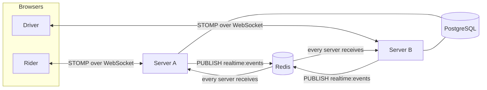
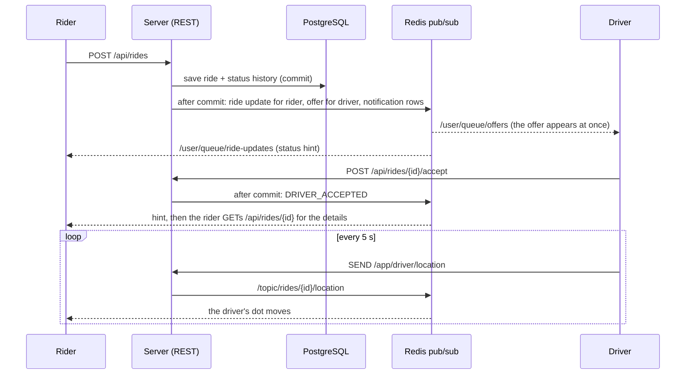

# Phase 5 review: WebSocket and real time

New to WebSocket and STOMP? Read [realtime-concepts.md](realtime-concepts.md) first. This is the review: what
changed, why, how it is proven, and how to defend it in an interview.

## 1. What changed, step by step

| Step | What we built | Where |
|---|---|---|
| 5.1 | WebSocket + STOMP endpoint `/ws`; JWT checked in the CONNECT frame (signature, expiry, issuer, Redis revocation); origin allow-list; per-frame authorization of every SUBSCRIBE and SEND; heartbeats | `realtime/RealtimeConfig`, `StompSecurityInterceptor` |
| 5.2 | Driver location streaming: driver app, WebSocket, Redis GEO, rider topic; REST endpoint for the last known position; per-driver rate limit | `realtime/DriverLocationStream`, `RideController` (`/driver-location`) |
| 5.3 | Ride status push: `Ride` records changes, Spring Data publishes `RideStatusChanged`, a listener pushes to rider and driver after commit | `ride/Ride`, `ride/RideStatusChanged`, `realtime/RideRealtimeListener` |
| 5.4 | Offers pushed to the driver instantly and withdrawn when answered, timed out or cancelled (the A-then-B retry logic from Phase 3 is reused) | `RideRealtimeListener`, `ride/RideDispatcher` |
| 5.5 | Notifications stored in PostgreSQL (V12) and pushed live; list, unread count, mark read, mark all read; driver approval and rejection notify too | `notification/*` |
| 5.6 | React: one `RealtimeClient` (connect, heartbeat, resubscribe, exponential backoff with jitter, token renewal), `useSubscription`, notification bell and page, connection indicator, live ride tracker with the driver moving on the map, instant offers | `frontend/.../realtime`, `features/notifications`, `RideDetailPage`, `DriverDashboard` |
| 5.7 | Scaling: every message goes through a Redis pub/sub channel that every server listens to | `realtime/RedisRealtimeBridge` |

## 2. Architecture

### A ride, seen live

## 3. Decisions and reasons

| Decision | Reason |
|---|---|
| Token in the **CONNECT frame**, not in the URL | Browsers cannot set headers on a WebSocket handshake, and URLs end up in logs. |
| Re-check the token on **every** frame | A socket outlives the 15-minute token. Expiry and revocation must still apply. |
| Origin allow-list | Stops other websites from opening a socket with your logged-in browser (cross-site WebSocket hijacking). |
| Authorize each SUBSCRIBE and SEND | One authenticated connection carries many messages; without per-destination rules anyone could watch any ride by guessing an id. |
| Per-user queues for personal events, a topic only for the ride location | Personal events are private by construction. Location belongs to the ride and has exactly the participants as audience. |
| Push a **hint**, fetch details over REST | What a rider may see differs from what a driver may see; REST remains the one place that decides it. Nothing sensitive in a broadcast. |
| Push **after commit** | Never announce a change the database may still roll back. |
| `Ride` records events; Spring Data publishes them on save | The ride module stays unaware of WebSockets. One place (`moveTo`) guarantees every status change produces exactly one event. |
| Notifications saved in a **new transaction** after the ride commit | A notification problem must never roll back or fail a ride. |
| Notifications stored **and** pushed | WebSocket delivery is fire-and-forget; the stored row is the memory, and the bell re-reads the count on every (re)connection. |
| All pushes through **Redis pub/sub** | Spring's broker is per-server memory. A shared channel makes every server deliver to its own browsers, so any number of servers works with the same code. |
| Local delivery fallback when Redis is down | Better to serve this server's browsers than nobody. |
| Heartbeats 10 s | Detect silently dead connections quickly. |
| Backoff 1, 2, 4 ... 30 s plus up to 25% jitter | Avoid a thundering herd when a server returns. |
| Re-subscribe after every reconnect, renew the token before it expires | A new connection starts with no subscriptions; the server refuses expired tokens. |
| REST remains as fallback for location, and slower polling stays as a safety net | The feature degrades to Phase 3 behaviour instead of breaking. |
| Location updates rate-limited per driver (20 per 10 s, in Redis) | A buggy client must not flood Redis and the rider's screen. |

## 4. How each claim is proven

All on a real PostgreSQL, Redis and a real STOMP client over a real WebSocket (`StompTestClient`).

| Claim | Test |
|---|---|
| A valid token connects | `WebSocketSecurityIntegrationTest.aValidTokenConnects` |
| No token, garbage token, expired token, suspended user's token: refused | `noTokenNoConnection`, `aGarbageTokenIsRefused`, `anExpiredTokenIsRefused`, `aSuspendedUsersTokenCannotOpenASocket` |
| A stranger cannot listen to someone else's ride; participants and admins can | `aStrangerCannotListenToSomeoneElsesRide`, `theRiderTheDriverAndAnAdminMayListenToARidesLocation` |
| Unknown destinations cannot be subscribed to; riders cannot send locations; nobody can publish to a topic | `anyOtherDestinationIsRefused`, `aRiderCannotSendDriverLocations`, `nobodyMaySendToOtherDestinations` |
| An open socket stops working after its user is suspended | `aSocketStopsWorkingAfterItsUserIsSuspended` |
| A message published by "another server" reaches browsers connected here; messages for others are not delivered; garbage on the channel is survived | `aMessageFromAnotherServerReachesTheBrowsersConnectedHere`, `aMessageAddressedToAnotherUserIsNotDeliveredToMe`, `aMalformedMessageOnTheChannelIsIgnored` |
| Every step of a ride is pushed to rider and driver; pushes carry no ride data | `LiveRideIntegrationTest.everyStepOfARideIsPushedToTheRiderAndTheDriver` |
| A bystander hears nothing about someone else's ride | `aBystanderHearsNothingAboutSomeoneElsesRide` |
| Decline moves the offer from driver A to B and removes it from A's screen; rider cancel withdraws it | `whenTheFirstDriverDeclines...`, `anOfferIsWithdrawnWhenTheRiderCancelsBeforeAnyAnswer` |
| The driver's streamed position reaches the rider and the REST endpoint; only participants may read it; only while on the way | `theDriversStreamedPositionReachesTheRiderAndTheRestEndpoint`, `theDriverLocationEndpointIsOnlyForParticipantsAndOnlyWhileOnTheWay` |
| Invalid or too-early location messages get an error on the sender's private queue | `anInvalidPositionGetsAnErrorOnTheSendersOwnQueue`, `aDriverWhoIsOfflineIsToldToGoOnlineFirst` |
| Notifications are stored and pushed; read state and ownership work; approval notifies the driver | `notificationsAreStoredAndPushedLive`, `readingNotificationsUpdates...`, `aNewlyApprovedDriverIsNotified` |
| Status changes make the ride emit exactly the right events | `RideEventsTest` |
| Backoff maths and token expiry parsing | `RealtimeClient.test.ts` |

## 5. Interview questions

**Why WebSocket and not polling?**
Polling costs a request per client per interval even when nothing changed, and updates arrive late. WebSocket keeps
one connection open so the server pushes the moment something happens. Polling stays as a fallback.

**What does STOMP add to WebSocket?**
Raw WebSocket is just a pipe of messages. STOMP adds frames (CONNECT, SUBSCRIBE, SEND, MESSAGE), destinations and
subscriptions, so many logical channels share one connection and the framework can route and authorize them.

**How do you authenticate a WebSocket?**
The browser cannot set headers on the handshake, so the JWT is sent in the STOMP CONNECT frame and verified by a
channel interceptor with the same rules as HTTP (including revocation). Then every later frame is re-checked,
because the connection outlives the token.

**What is the difference between a topic and a user queue?**
A topic is shared: every subscriber gets each message. A user queue is private: the framework rewrites the
destination per user, so a message addressed to user X reaches only X's sessions.

**How does it scale beyond one server?**
The in-memory broker only knows its own server's sessions. We publish every message to a Redis channel that all
servers subscribe to; each delivers to its own browsers. Alternatives: a broker relay to RabbitMQ.

**What can go wrong with that design?**
Redis pub/sub is at-most-once: a server that is down misses messages. We accept that for UI hints and keep the
truth in REST and the database (notifications are stored).

**Why push after commit?**
If we pushed inside the transaction and it rolled back, users would have been told about something that never
happened.

**How do you handle reconnects?**
Heartbeats detect dead connections; the client retries with exponential backoff and jitter to avoid a thundering
herd; after reconnecting it resubscribes everything and re-reads state over REST (the bell count), because messages
sent while it was away are gone.

**Why not send the full ride in the push?**
Each viewer may see different fields (phone numbers appear after acceptance). Pushing only a hint keeps REST the single
authority and keeps secrets out of broadcast channels.

**How do you stop one driver from flooding the system?**
Updates beyond 20 per 10 seconds are dropped, counted in Redis (the same counters as rate limiting).

## 6. Known limits (honest list)

* **At-most-once delivery.** A message sent while a browser is disconnected is lost; the REST refresh and the stored
  notifications compensate.
* **A silent socket of a suspended user** keeps receiving pushes until it speaks again or its token expires
  (at most 15 minutes), because Spring offers no direct "close all sessions of this user". The next frame it sends
  is refused. A session registry that closes sockets on revocation is the improvement.
* **Offer timeouts tick every 5 seconds** (background job), so an unanswered offer can last up to about 35 seconds
  instead of exactly 30. A Redis sorted set of deadlines would make it exact.
* **Straight-line position only:** no route snapping or smoothing; the driver's dot moves between pings.
* **One Redis**, one pub/sub channel: fine at this size; at very large scale partition by region or use a broker.
* **Heartbeat load:** every connected browser costs a socket; thousands of connections per server need tuning (threads,
  file descriptors) and load testing.
