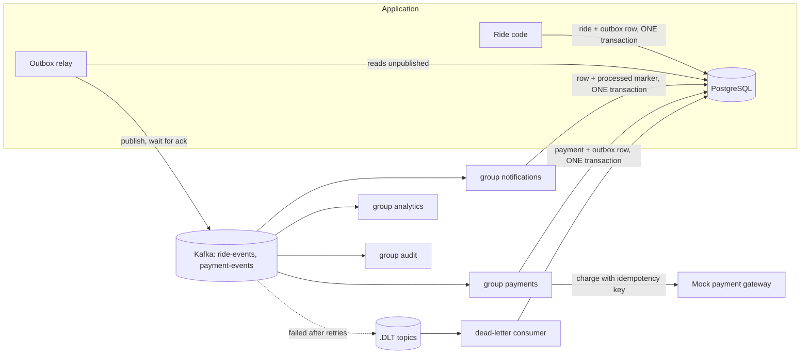

# Phase 6 review: Kafka and event-driven design

New to Kafka? Read [kafka-concepts.md](kafka-concepts.md) first. This is the review: what changed, why, how it is proven, and how to defend it in an interview.

## 1. What changed, step by step

| Step | What we built | Where |
|---|---|---|
| 6.1 | Kafka (KRaft, one broker) in Docker Compose, Spring for Apache Kafka, producer settings (`acks=all`, idempotent producer), consumer settings (manual commit per record, start from earliest) | `docker-compose.yml`, `application.properties` |
| 6.2 | Topics `ride-events` and `payment-events` (3 partitions, key = ride id); event envelope with id, type, version; **outbox pattern**: events saved in the same transaction as the ride change, a relay publishes them | `events/*`, migration V13 |
| 6.3 | Four independent consumer groups on the same events: notifications, analytics, audit, payments | `notification/NotificationEventConsumer`, `analytics/`, `audit/`, `payment/PaymentConsumer` |
| 6.4 | Retries with growing pauses, **dead-letter topics**, poison messages skip retries, **idempotent consumers** (`processed_events`) | `events/KafkaConfig`, `ProcessedEvents`, `DeadLetterConsumer` |
| 6.5 | Mock payment gateway with idempotency keys, payments table (one per ride), payment events, REST for status and retry, admin list | `payment/*`, migration V14 |
| 6.6 | Notifications now come from Kafka instead of an in-process listener | `NotificationEventConsumer` replaces `RideNotificationListener` |
| 6.7 | Kafka in Testcontainers, tests for every claim, consumer lag endpoint, this review | `src/test/.../events`, `payment`, `ConsumerLagService` |

Frontend: a payment card on the completed ride page (waits for the event-driven payment, shows failure and a retry button), admin **Payments** page, admin **Events** page (consumer lag, outbox backlog, dead letters, rides per day from events, audit trail of one ride).

## 2. Architecture



### One completed ride
```mermaid
sequenceDiagram
    participant Driver
    participant API as Ride service
    participant PG as PostgreSQL
    participant Relay
    participant Kafka
    participant Pay as Payments consumer
    participant Note as Notifications consumer
    Driver->>API: POST /complete
    API->>PG: ride COMPLETED + outbox row (commit)
    Relay->>PG: unpublished rows
    Relay->>Kafka: ride.status-changed (key = ride id)
    Relay->>PG: mark published
    Kafka-->>Pay: event
    Pay->>PG: processed marker + payment + outbox row (one transaction)
    Pay->>Pay: charge mock gateway with key ride-ID-attempt-1
    Relay->>Kafka: payment.succeeded
    Kafka-->>Note: both events: notifications for rider and driver
```

## 3. Decisions and reasons

| Decision | Reason |
|---|---|
| Events instead of direct calls | The ride code no longer knows about notifications, payments or analytics. New reactions need no ride changes; a slow consumer cannot slow or break a ride. |
| **Outbox pattern** | Saving to PostgreSQL and sending to Kafka cannot share a transaction (the dual-write problem). The outbox row commits with the change, so an event is never lost and never describes a rolled-back change. |
| Relay: oldest first, stop at the first failure, one relay at a time (advisory lock) | Skipping ahead or two relays interleaving would deliver a ride's later event before its earlier one. |
| Key = ride id | Kafka orders messages only within a partition; one key means one partition, so a ride's events stay in order while rides run in parallel. |
| One topic per kind of fact; events in the past tense | Consumers come and go, the facts stay. |
| Envelope with `eventId`, `type`, `version` | The id enables duplicate detection; the version lets the data shape evolve. |
| At-least-once delivery plus idempotent consumers | Exactly-once across systems is impractical; safe repetition is achievable. |
| `processed_events` written in the **same transaction** as the work | A crash in the middle rolls both back (the retry does the work); a redelivery after success finds the marker (skipped). |
| Retries with growing pauses, then a dead-letter topic | Temporary failures heal; permanent ones are parked so they never block the partition behind them. |
| Poison messages skip retries | Retrying a broken message can never help. |
| Separate consumer groups | Each reads everything with its own offset; one group being slow or down does not affect the others, and a new group can replay history. |
| Payment: five layers (consumer marker, unique ride, status check, idempotency key, gateway memory) | Any single layer failing is caught by the next; charging twice is the worst bug a payment system can have. |
| New idempotency key per retry attempt | Reusing the key would just return the old decline. |
| Verification and reset **emails stay in-process** | They carry secret tokens; Kafka retains messages for days and every consumer can read them. Notifications contain nothing secret, so they moved. |
| Live WebSocket push stays direct (not through Kafka) | It is ephemeral and latency-critical; Kafka adds a hop and is for things that must not be lost. |
| Lag exposed to admins | The first number to check when a Kafka system misbehaves. |

## 4. How each claim is proven (tests)

All on real PostgreSQL, Redis and Kafka (Testcontainers).

| Claim | Test |
|---|---|
| Same key stays in one partition in order; different keys spread | `KafkaFundamentalsIntegrationTest` |
| Each group receives everything; members of one group share partitions without overlap | same class |
| A restarted consumer resumes at its committed offset | `aGroupRemembersItsOffset...` |
| An event cannot be appended outside a transaction; a rolled-back transaction leaves no event | `OutboxIntegrationTest` |
| Every ride change becomes an event, delivered keyed by ride and in order, with headers and a versioned envelope | `OutboxIntegrationTest` |
| Failing Kafka: nothing marked, nothing sent out of order, retried later; only one relay at a time | `OutboxRelayTest` |
| Notifications, analytics, audit and payment groups each do their job and keep their own record | `ConsumersIntegrationTest` |
| Lag reaches 0 in every group | `ConsumersIntegrationTest`, `AdminEventsIntegrationTest` |
| The same event delivered again and again changes nothing | `IdempotencyIntegrationTest` |
| A failed attempt leaves no "handled" marker | `aGroupRecordsAnEventAsHandledOnlyTogetherWithItsWork` |
| Garbage goes to the dead-letter topic of every group, with the reason and origin; later events are not blocked | `DeadLetterIntegrationTest` |
| Temporary failures are retried before dead-lettering; a failing group does not stop the others | `DeadLetterIntegrationTest`, `ConsumersIntegrationTest` |
| A completed ride is charged once for its fare, result published, rider and driver notified | `PaymentIntegrationTest` |
| The completion event redelivered, or sent again with a different id, never charges twice | `PaymentIntegrationTest` |
| The gateway returns the original result for a repeated key; declines above its limit | `PaymentIntegrationTest` |
| A decline marks the payment failed; retry uses a new key; only the rider may retry, only a failed payment | `PaymentIntegrationTest` |
| Who may see payments and the event admin endpoints | `PaymentIntegrationTest`, `AdminEventsIntegrationTest`, `PermissionMatrixIntegrationTest` |
| Payment state rules | `PaymentTest` |
| Frontend helpers | `payments.test.ts` |

## 5. Interview questions

**Why events and not direct calls?**
Direct calls couple the ride code to every reaction and make one failure break the others. With events the producer states a fact and moves on; consumers are independent, can be added later, and can catch up after downtime.

**What is the dual-write problem and how do you solve it?**
Updating two systems (database and Kafka) that cannot share a transaction can leave them inconsistent. The outbox pattern writes the event to a table in the same transaction as the change, and a separate relay publishes it, giving at-least-once delivery.

**Explain partition, offset, consumer group.**
A topic is split into partitions, each an ordered log; an offset is a message's position in its partition. A consumer group shares a topic's partitions among its members; each group tracks its own offsets, so groups are independent.

**How do you keep events of one ride in order?**
Use the ride id as the message key: the same key always goes to the same partition, and Kafka orders messages within a partition. The relay also publishes in sequence and stops on failure.

**At-most-once, at-least-once, exactly-once?**
At-most-once may lose, at-least-once may duplicate, exactly-once is very hard across systems. We use at-least-once and make consumers idempotent.

**How do you make a consumer idempotent?**
Record "this group handled this event id" in the same transaction as the work, with a primary key on (group, event id). A duplicate hits the primary key and is skipped; a crash rolls both back.

**What is a dead-letter topic and why not retry forever?**
After a limited number of retries the message is published to a separate topic and the consumer moves on. Retrying forever would block the whole partition behind one poison message.

**How do you avoid charging twice?**
Layers: idempotent consumer, one payment per ride in the database, the automatic flow never re-charges a settled payment, and an idempotency key on every gateway call so the gateway returns the original result for a repeat. A retry is a new attempt with a new key.

**What is consumer lag?**
For each partition, the newest offset minus the group's committed offset. Zero means caught up; growing means the group cannot keep up or is down.

**Kafka vs Redis pub/sub vs RabbitMQ?**
Redis pub/sub does not store messages (good for instant UI hints). RabbitMQ is a broker that delivers and deletes (good for task queues). Kafka keeps a replayable log that many independent groups read at their own pace (good for business events).

**What are the costs of going event-driven?**
Eventual consistency (a payment appears a moment after the ride completes), more infrastructure, harder debugging across services, and the need for idempotency, retries and monitoring. The payoff is decoupling and resilience.

## 6. Known limits (honest list)

* **One broker, replication factor 1.** A broker loss loses data and availability. Production uses at least three brokers, replication 3 and `min.insync.replicas=2`.
* **Blocking retries.** A failing message pauses its partition during the retry pauses (bounded, a few seconds). Retry topics avoid that but give up ordering.
* **Dead letters are not replayed automatically.** An admin can see them; a "re-publish" button is the natural next feature.
* **The relay polls** every 500 ms, so events lag by up to that long. Change data capture (Debezium) would remove the polling.
* **Schema evolution is by convention** (the `version` field). A schema registry (Avro or Protobuf) would enforce compatibility.
* **The gateway call happens inside the database transaction.** Safe here because of the idempotency key (a retry returns the original result), but a real gateway call should be kept short.
* **Analytics counts events, not distinct rides**, and a day boundary uses UTC.
* **Kafka's own configuration** (retention, compaction, ACLs, TLS) is left at development defaults.
