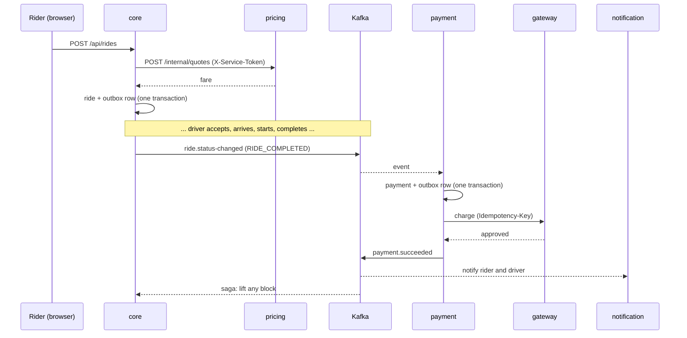

# Phase 7 review: from one application to a set of services

New to the ideas? Read [microservices-concepts.md](microservices-concepts.md) first. The one-page picture is the [service map](service-map.md); the event rules are in [event-contracts.md](event-contracts.md). This document is the review: what changed, why, how to run it, how each failure behaves, and how to defend it in an interview.

## 1. What changed, step by step

| Step | What we built | Where |
|---|---|---|
| 7.1 Boundaries and contracts | Decision of what to extract and what not (with reasons). The **platform library** (contracts, outbox, idempotent consumers, JWT validation, error shape; no business code). JSON schemas for every event. **Architecture tests** that fail the build when a boundary is crossed | `backend/pom.xml` (multi-module), `platform/`, `platform/src/main/resources/contracts/events/`, `architecture-tests/` |
| 7.2 Auth and token sharing | Auth and users **stay in the core** (reasons below). Tokens move from a shared secret to **RS256 + JWKS**: services verify, cannot forge. Shared Redis revocation list. Service-to-service token for internal calls. Database per service with **expand/contract** data migration | `ridex-app/.../jwt/JwtKeys`, `JwksController`, `platform/.../security/`, importers in each service, `docs/sql/phase-7-contract.sql` |
| 7.3 Notification service | Pure event consumer, its own database, REST for "my notifications", live push through Redis to the core's WebSockets. Also reacts to the new `driver.application-reviewed` event | `notification-service/` |
| 7.4 Payment service + Resilience4j | Payment moved out. Gateway reached over **HTTP** with timeout, retry, circuit breaker, bulkhead. "No answer" is treated as unknown, not as failure. Mock gateway with idempotency keys and a **chaos switch**. Admin panel to watch it | `payment-service/`, `GatewayPanel.tsx` |
| 7.5 Pricing and matching | **Pricing extracted** (stateless) and called **synchronously** over REST with timeout, retry, circuit breaker; 503 when down. **Matching stays** in the core (reasons below). Sync vs async compared | `pricing-service/`, `ridex-app/.../pricing/HttpPricingClient` |
| 7.6 Analytics and eventual consistency | Analytics, audit log, dead letters and consumer lag moved to their own service, built only from events | `analytics-service/` |
| 7.7 Cross-service workflows | The **ride-payment saga** (choreography): a failed payment compensates by blocking the rider until it is settled. Why 2PC is avoided | `ridex-app/.../saga/`, migration V15 |
| 7.8 Review | This document, service map, failure scenarios, interview questions | `docs/` |

## 2. What was deliberately NOT extracted

| Candidate | Decision | Reason |
|---|---|---|
| Auth + users | stays in the core | Needed on every request by every service; it is the **identity provider**. Splitting it adds a network call to everything for no gain, and token issuing needs the user table. We did split the *verification* (public key) from the *issuing* (private key) |
| Rides + matching + drivers | stay in the core | They share one transaction: accepting a ride locks the ride row, checks and changes the driver's availability, and releases a Redis lock. Optimistic locking, `FOR UPDATE SKIP LOCKED` and the geo index rely on one database and low latency |
| Ratings | stays in the core | Reads the ride to check "was this person on it, and is it completed?" in the same transaction. A rating without that check is a data-integrity bug |

An honest summary for an interview: *we extracted what had weak coupling and a different failure profile, and kept together what shares a transaction.* More services is not more maturity.

## 3. Architecture in one picture

See the diagram in the [service map](service-map.md#2-who-talks-to-whom). Summary:

* **Browser → gateway → services.** One address for the browser; routing by path prefix.
* **Events** (Kafka) for facts: rides, payments, driver reviews. Each publisher uses its own **outbox**.
* **REST** for one question: the core asks pricing "what does this cost?".
* **Tokens** are issued by the core and verified locally everywhere with the public key.

### The complete journey of one ride


## 4. Decisions and reasons

| Decision | Reason |
|---|---|
| One repository, several Maven modules | One person; the boundary is in the code and enforced by tests. Each module still has its own `pom`, port, database and `main` |
| Platform library for infrastructure only | Sharing code is how services become a distributed monolith. Only things with no business meaning are shared |
| JSON schemas + contract tests | An event is an API; APIs need a written, tested agreement |
| RS256 + JWKS | Verifying must not imply the power to forge. Keys can be rotated with `kid` |
| Shared Redis for the revocation list (read-only in services) | Logout and suspension must hold everywhere at once; the core stays the only writer |
| Database per service, no cross-service foreign keys | Prevents invisible coupling through the schema. Enforced by `DatabasePerServiceTest` |
| Expand/contract, contract left manual | The only irreversible step is dropping the old table; it needs a human who has compared the counts |
| Pricing: synchronous. Payment/notification/analytics: asynchronous | A rider is waiting for a price; nobody is waiting for a receipt |
| Resilience4j core libraries, used programmatically | No Spring Cloud dependency; the order of the decorators is visible in one place |
| "No answer" ≠ "declined" | Treating a timeout as a failure can mean charging twice or never. The idempotency key makes the retry safe |
| Choreography saga | Two services, one compensating step: an orchestrator would be more machinery than the flow justifies |
| The core keeps `rider_payment_blocks` | It must answer "may this rider book?" instantly, even when payment is down |
| Frontend routes with a proxy that acts as an API gateway | Browser knows one address; service layout can change without touching the UI |

## 5. Failure scenarios (try them)

Start everything with `scripts/start-services.ps1`, log in as a rider and a driver, and use two browsers.

| # | What you do | What happens | Why it is safe |
|---|---|---|---|
| 1 | Stop **pricing**. Rider tries to book | `503` "Pricing is temporarily unavailable" + `Retry-After`. After ~5 failed attempts the circuit opens and the answer is instant. Start pricing: works again after ~10 s | No ride is created without a real price. No invented fare |
| 2 | Stop **payment**. Complete a ride | Ride completes normally; the payment card says "processing". Start payment: it reads the missed event and charges once | Events wait in Kafka; the consumer is idempotent |
| 3 | Stop **notification**. Do rides | No notifications. Start it: the missed ones appear, in order | Same |
| 4 | Admin Payments page → *Returns errors*. Complete a ride | Payment stays *Processing*; retries; the circuit opens (watch the badge and "calls refused"). Switch to *Works normally* (and *Close the circuit*): the payment completes | "No answer" is not a failure; same idempotency key; circuit protects the gateway and us |
| 5 | *Charges, then answers too late*. Complete a ride | We time out, the gateway **did** charge. Payment stays *Processing*, then when asked again the gateway returns the original charge: `mock_gateway_charges` has **one** row | Idempotency key |
| 6 | *Hangs* | Calls time out at 1.5 s each; a bulkhead limits parallel calls to 5; the service stays responsive | Timeout + bulkhead |
| 7 | Make a payment **fail for good** (below) | Rider gets a "payment failed" notification; **booking a new ride is refused (409)** until they retry and pay | Saga compensation |
| 8 | Stop **Kafka** (`docker stop ridex-kafka`), do some ride steps, start Kafka | Admin Events page shows "events not yet sent to Kafka" growing, then back to 0, in order | Outbox |
| 9 | Stop **analytics** | Nothing visible to riders or drivers. Admin events page is empty/error. Start: it catches up | Pure consumer |
| 10 | Replay a message twice (tests do it) | One notification, one payment, one count | Idempotent consumers |
| 11 | Send garbage to `ride-events` (tests do it) | Goes to `ride-events.DLT`, appears on the Events page as a dead letter; everything behind it keeps flowing | Poison messages skip retries |

**To force a decline** (scenario 7): the test card declines amounts above 5000, which a normal ride never reaches. Start the payment service with a lower limit, for example in PowerShell:

```powershell
$env:RIDEX_PAYMENTS_MOCK_DECLINE_ABOVE_AMOUNT = "100"
.\scripts\start-services.ps1 -Only payment
```

(This is relaxed binding: the environment variable overrides `ridex.payments.mock.decline-above-amount`.) Remove the variable and restart afterwards.

## 6. How it is proven

| Layer | What the tests do | Where |
|---|---|---|
| Contracts | Records, schemas and sample events agree; a rename or a type change is caught; a newer producer's extra field is tolerated | `platform` `ContractSchemaTest`, `EventCodecTest` |
| Outbox relay | Order, stop-on-failure, confirmed-only marking, single relay | `platform` `OutboxRelayTest` |
| Boundaries | No service imports another; platform has no business code; only the outbox publishes in the core; consumers are idempotent; ride code never touches HTTP; remote calls use a circuit breaker; no foreign key leaves a database | `architecture-tests` |
| Notification service | Real PostgreSQL, Kafka, Redis: each ride step notifies the right person; duplicates; poison to DLT; forged, expired and foreign tokens refused; revocation honoured | `notification-service` |
| Payment service | One charge per ride even with duplicate events; decline; gateway errors, hang, charge-then-late-answer; circuit opens and closes; outage exhaustion; roles | `payment-service` |
| Pricing service | Formula (unit); REST with rider token and with service token; refuses everyone else; starts with no database | `pricing-service` |
| Analytics service | Audit exactly once; daily counts; dead letters; lag; admin only | `analytics-service` |
| Core | Pricing client against a fake that errors, hangs and recovers; saga with real Kafka; outbox; token filter; RS256 | `ridex-app` |
| Frontend | Type check, lint, unit tests, production build | `frontend/ridex-web` |

### Final results

| Module | Tests |
|---|---|
| platform | 19 |
| core (ridex-app) | 423 (420 + 3 JWKS) |
| notification-service | 21 |
| payment-service | 19 |
| pricing-service | 19 |
| analytics-service | 7 |
| architecture-tests | 17 |
| **Backend total** | **525** |
| frontend (vitest) | 76 (plus tsc, eslint and production build clean) |

All run with `cd backend; .mvnw.cmd install` against real PostgreSQL, Redis and Kafka in Docker. The count of the core is lower than before Phase 7 because notification, payment, pricing and event tests moved to the services that now own that code.

## 7. Interview questions and answers

**1. Why did you not split everything into microservices?**
Splitting costs: network calls, partial failure, distributed data. I extracted pieces with weak coupling and a different failure profile (notifications, payments, pricing, analytics). Rides, drivers and matching share one transaction and one low-latency path, so splitting them would add risk and no benefit.

**2. How do you decide a service boundary?**
By bounded context and by coupling: does it change for different reasons, does it need the same transaction as its neighbours, can it fail without the user noticing, does it already communicate through events? I also look for the data it owns.

**3. What is a distributed monolith and how did you avoid it?**
Services that must be deployed together or share a database. I avoided it with a database per service (enforced by a test), a platform library with no business logic (enforced by a test), versioned event contracts with tolerant readers, and no shared domain classes.

**4. How do services trust a token?**
The core signs with a private RSA key and publishes the public key (JWKS). Services verify signature, expiry and issuer locally, with no call to the core per request, and check a Redis revocation list so logout and suspension apply everywhere. A service can verify but cannot forge.

**5. Why not a shared secret?**
Everything that can verify could also mint admin tokens; one leak anywhere compromises authentication everywhere.

**6. How is data migrated out of the monolith safely?**
Expand/contract. The new service creates its table and copies the old rows; the old table stays, unused. After verification a human runs the contract script. Rollback is possible until that last step.

**7. Synchronous or asynchronous, and how do you choose?**
Questions that the caller must have the answer to, now, are synchronous (price). Facts that others may react to later are asynchronous (ride completed). Async removes coupling in time and failure; sync gives immediate answers.

**8. What happens when the pricing service is down?**
The core's call times out, is retried, then the circuit opens. The rider gets 503 with `Retry-After`. No ride is created, no price is guessed. Everything already in progress continues.

**9. What do timeout, retry, circuit breaker and bulkhead each prevent?**
Timeout: threads stuck on a hung dependency. Retry: failure from a momentary glitch (only safe if idempotent). Circuit breaker: hammering a failing dependency and waiting on every call. Bulkhead: one slow dependency consuming all capacity.

**10. A payment call times out. Do you retry?**
Yes, but only with the same idempotency key, because the first call may have succeeded. The gateway returns the original result for a repeated key. Until then the payment is PENDING, not failed.

**11. What is a cascading failure?**
One failing service slows its callers, which slows theirs, until everything is down. Timeouts, circuit breakers, bulkheads and asynchronous design are the firebreaks.

**12. Why is a distributed transaction hard?**
2PC blocks while waiting for the coordinator, requires every participant to support it, and the whole thing is only available if all participants are. Real systems use sagas with compensation and accept eventual consistency.

**13. Describe your saga.**
Ride completes in the core (local transaction) → event → payment service charges (local transaction) → success or failure event → the core reacts. On failure the compensation is a business action: block the rider from new bookings until they pay. The ride cannot be undone, so compensation is not a rollback.

**14. Choreography or orchestration?**
Choreography here: two services and one compensating step. As the number of steps and branches grows, orchestration (a central coordinator, or a workflow engine) becomes easier to reason about, at the cost of one more component that knows the flow.

**15. How do you guarantee an event is published if the database commit succeeds?**
Outbox: the event row is written in the same transaction as the change; a relay publishes it afterwards and marks it published. At-least-once, in order per key, consumers are idempotent.

**16. How do you test across services?**
Per-service integration tests against real infrastructure with other services simulated by publishing their events; contract tests for event shapes; architecture tests for boundaries; fault tests for the resilience behaviour. Few end-to-end tests, because the others cover the same risks more cheaply and reliably.

**17. How would you scale this?**
Stateless services (pricing) behind a load balancer; Kafka partitions and consumer groups for consumers (one consumer per partition per group); the core horizontally behind a gateway, with Redis already sharing WebSocket fan-out and rate limits across instances; a database per service, scaled separately.

## 8. What is still simplified

* One Kafka broker, one PostgreSQL server (four databases). Production would replicate both.
* The service token is a shared secret; production would use mutual TLS or a service mesh.
* The API gateway is the Vite proxy; production uses nginx, Kong or a cloud gateway, with TLS, rate limiting and request logging.
* No distributed tracing yet: correlating one ride across five services needs trace ids in logs and events (a later observability phase).
* No service discovery: addresses are configuration. Kubernetes (a later phase) provides it.
* Each service has its own build; a CI pipeline per service is a later phase.
