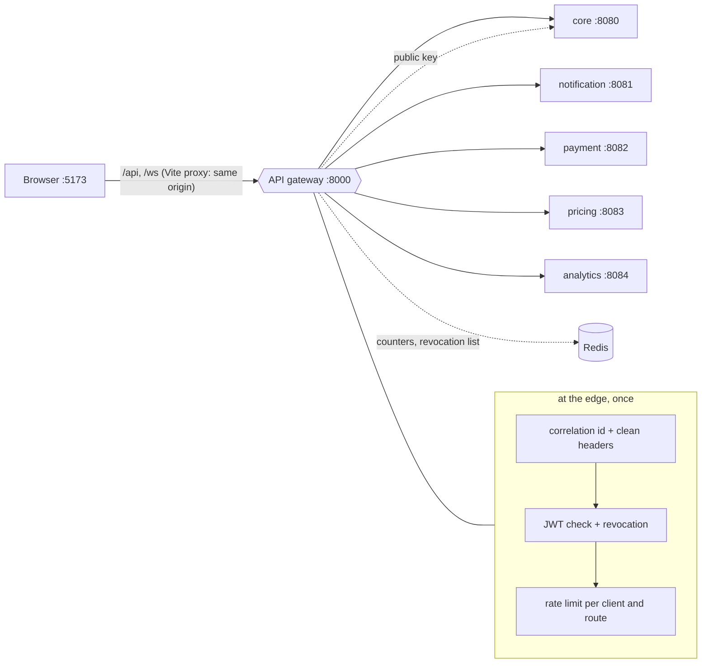

# Phase 8 review: the API gateway

New to the ideas? Read [gateway-concepts.md](gateway-concepts.md) first. The picture of the whole system is the [service map](service-map.md). This document is the review: what changed, why, how to run it, how it fails, and how to defend it in an interview.

## 1. What changed, step by step

| Step | What we built | Where |
|---|---|---|
| 8.1 Routing | New module `api-gateway` (Spring Cloud Gateway, reactive, port **8000**). Routes by path to the five services, WebSockets included. Paths that exist only inside the platform (`/internal`, `/mock-gateway`, `/actuator`) answer 404 from outside | `backend/api-gateway/src/main/resources/application.yml`, `RequestContextFilter` |
| 8.2 JWT at the edge | Token checked once at the gateway (signature, expiry, issuer, **revocation in Redis**). `X-User-Id` / `X-User-Role` added for the services; client-sent copies removed. `Authorization` passed on unchanged so every service **checks again** | `JwtEdgeFilter`, `GatewayConfig` |
| 8.3 Rate limiting, CORS, logging | Redis token-bucket limits per client and per route (login stricter). One CORS policy. Access log with correlation id; the id appears in **every service's** log lines. Real client address passed to services (and trusted by the core only from internal addresses) | `application.yml`, `ClientAddressHeadersFilter`, `GatewayErrorHandler`, `platform/.../web/RequestIdFilter`, core `server.forward-headers-strategy=native` |
| 8.4 Discovery decision | Decision: addresses stay in configuration now, Kubernetes DNS later, **no Eureka**. Written up with the alternatives. `GET /gateway/services` (admin) reports which services are alive | `docs/gateway-concepts.md` section 5, `GatewayStatusController` |
| 8.5 Frontend → gateway only | `vite.config.ts` proxies `/api` and `/ws` to the gateway and nothing else: same origin for the browser | `frontend/ridex-web/vite.config.ts` |

Also: start/stop/status scripts know the gateway; architecture tests added for it (it depends on no service and not even on the platform library; it has no database or Kafka; no service depends on it).

## 2. Architecture



### One request, in order
1. The gateway gives it an `X-Request-Id` and deletes any `X-User-*` the client sent. Internal paths: 404.
2. Public path? Continue. Otherwise the token must be valid and not revoked, or: `401`, and no service is bothered.
3. The route's rate limiter takes a token from the client's bucket, or answers `429`.
4. The request is forwarded with `X-User-Id`, `X-User-Role`, `X-Request-Id`, `X-Forwarded-For` (real address) and the original `Authorization`.
5. The service verifies the token again and applies its own rules. 6. The gateway logs one line: method, path, status, time, user.

## 3. Decisions and reasons

| Decision | Reason |
|---|---|
| Spring Cloud Gateway (reactive WebFlux) | A gateway mostly waits for other servers; reactive uses few threads for many connections. Built-in routes, rate limiter, CORS, WebSocket relay |
| Separate module that does **not** use the platform library | The platform library is servlet based; the gateway is reactive. Sharing it would also couple the front door to the services' code. A test enforces it |
| Validate at the edge **and** in services | Cheap early rejection plus defence in depth: a bypassed or breached gateway does not expose the services |
| Services ignore `X-User-*` for security | Anyone who reaches a service directly could forge them. They are for logs only |
| Authorization stays in the services | "May this rider see this ride?" needs business data |
| Coarse limits at the gateway, fine limits in the core | The gateway sees a client's rate; only the core knows an email's failed logins |
| Rate limit key = client address + route | Hammering login must not use up the budget for the rest of the API |
| Trust X-Forwarded-For only from internal addresses (core) | Otherwise a client reaching the core directly could pick its own bucket; without it everyone behind the gateway would share one |
| WebSocket handshake is public at the edge | Browsers cannot send a header on it; the token travels in the STOMP CONNECT frame and the core checks it |
| No Eureka | Kubernetes already provides discovery and load balancing; two registries would be redundant |
| Same origin in the browser (proxy), CORS still configured | No CORS problems or preflights in normal use; CORS exists for legitimate direct callers |
| Spring Cloud 2025.1.3 on Boot 4.1.1 | 2026.0 is not released yet. 2025.1.x targets Boot 4.0, and all 33 gateway tests plus a live run pass on 4.1.1; the pair is worth re-checking when 2026.0 is released |

## 4. Failure scenarios

| What happens | Result | Why |
|---|---|---|
| Request with no / bad / expired / forged token | `401` JSON at the edge; no service sees it | Edge check |
| Token of a logged-out or suspended user | `401` at the edge (Redis list), and again at any service | Shared revocation list |
| Client sends `X-User-Role: ADMIN` | Removed; the verified role is used | Header cleaning |
| Client calls `/internal/quotes` | `404`, nothing forwarded | Blocked paths |
| One service is down | That route answers `503` with `Retry-After` in the usual JSON; every other route works; when it returns, the same route works again with no gateway restart | Per-route forwarding |
| A service is slow | `504` after the timeout instead of hanging the caller | Gateway error handler |
| Client floods one route | `429` for that client on that route only | Per-route buckets |
| Redis down | Gateway lets traffic through (limiter and revocation fail open, with warnings) | A cache outage must not take the front door down; services still verify tokens |
| Core down | The gateway keeps verifying tokens with the cached public key for a few minutes; then refuses | JWKS cache |
| Gateway down | Browsers have no address. Services still work on their ports. The gateway holds no state, so restarting (or running several) is safe | Stateless |
| Other website calls the API from a browser | Preflight refused (`403`), no CORS headers | Allow-list |

Try them: see section 6 for commands.

## 5. How it is proven

| Layer | What the tests do | Where |
|---|---|---|
| Routing | Each prefix reaches the right (fake) service; path, method and query arrive unchanged; everything else goes to the core; internal paths never reach any service | `GatewayRoutingAndSecurityTest` |
| Edge JWT | No token, garbage, expired, forged, foreign issuer, non-UUID subject, no role, wrong scheme: all `401`, zero hits on any service. Valid token: identity headers set and `Authorization` unchanged | same |
| Anti-spoofing | Client-written `X-User-*` and `X-Forwarded-For` never reach a service | same |
| Revocation | By token id, by user cut-off; newer tokens still work | same |
| CORS | Allowed preflight answered without a token; other origin refused; headers exposed | same |
| Rate limits | 429 after the burst; stricter for login; buckets per route; limited requests never reach the service | `GatewayRateLimitTest` |
| Dead services | 503 with Retry-After; other routes keep working; recovery without restart; admin-only service map | `GatewayStatusTest` |
| Core behind a gateway | Two clients behind the same proxy get separate rate-limit buckets | core `ApiRateLimitIntegrationTest` |
| Correlation id | Id kept or replaced, put in the logging context, removed afterwards | platform `RequestIdFilterTest` |
| Boundaries | Gateway depends on no service nor the platform; no database or Kafka; nobody depends on it | `ServiceBoundaryTest` |

### Final results (whole build: `cd backend; .\mvnw.cmd install`)

| Module | Tests |
|---|---|
| platform | 23 |
| core | 424 |
| notification-service | 21 |
| payment-service | 19 |
| pricing-service | 19 |
| analytics-service | 7 |
| **api-gateway** | **33** |
| architecture-tests | 20 |
| **Backend total** | **566** |

Frontend: type check, lint, unit tests and production build are run separately (see the end of this phase's summary).

## 6. Run it and try it

```powershell
$env:DB_PASSWORD = "<your ridex db password>"
.\scripts\build-all.ps1
.\scripts\start-services.ps1          # now starts the gateway too (port 8000)
.\scripts\status.ps1
cd frontend\ridex-web; npm run dev    # restart it: it now proxies to the gateway
```

Things to try (everything goes through port 8000; the browser uses http://localhost:5173 as before):

```powershell
curl.exe -i http://localhost:8000/api/health                    # 200 and an X-Request-Id header
curl.exe -i http://localhost:8000/api/rides                     # 401 from the gateway, no token
curl.exe -i -X POST http://localhost:8000/internal/quotes       # 404: internal paths are hidden
# log in, then call another service through the same address
curl.exe -s -X POST -H "Content-Type: application/json" --data "@docs/api-samples/login-ok.json" http://localhost:8000/api/auth/login
# use the token:  curl.exe -H "Authorization: Bearer <token>" http://localhost:8000/api/notifications   (notification service)
```

Watch the correlation id: take the `X-Request-Id` of any response and search for it in `logs\gateway.log` and in the service's log (`logs\core.log`...).

Rate limiting: run the `/api/auth/login` call about 20 times quickly; after the burst the answer is `429`.

Dead service: `.\scripts\stop-services.ps1`, then `.\scripts\start-services.ps1 -Only core,gateway`, and open the fare screen: pricing answers `503` (with Retry-After) while everything else works.

## 7. Interview questions and answers

**1. What is an API gateway and why use one?**
One entry point in front of several services. It does the work that is the same for every service (routing, token check, rate limiting, CORS, logging) once, hides the internal layout from clients, and lets services move without the frontend changing.

**2. Where should JWT validation happen: gateway or services?**
Both. The gateway rejects unauthenticated traffic early and cheaply; the services re-check because the gateway can be bypassed or compromised (defence in depth). Authentication (who) can be at the edge; authorization (what may they do) stays with the service that knows the data.

**3. Why not let services trust identity headers set by the gateway?**
Anyone who can reach a service directly could forge them. They are for logging and tracing only; the signed token is the proof.

**4. What do you put in a gateway and what do you keep out?**
In: routing, authentication, coarse rate limiting, CORS, logging, correlation ids, maybe TLS termination. Out: business rules, data access, orchestration of several calls. A gateway that grows logic becomes a second monolith.

**5. How does rate limiting work and where is the state?**
Token bucket per client and route: each request takes a token, tokens refill at a steady rate, bursts are allowed up to the bucket size. Counters live in Redis so several gateway instances share them. It fails open if Redis is down.

**6. What goes wrong with client IPs behind a gateway?**
Every request reaches the service from the gateway's address, so per-client limits treat everyone as one client. The gateway passes the real address in `X-Forwarded-For`, replacing anything the client wrote; the service accepts that header only from trusted internal addresses.

**7. How is WebSocket authentication handled?**
Browsers cannot set headers on a WebSocket handshake, so the handshake is public and the token is sent in the first STOMP frame; the core checks it there and on every later frame. The gateway just relays the connection.

**8. Explain CORS and why you still configured it if the frontend uses a proxy.**
CORS is the browser's rule for cross-origin calls. Through the dev proxy (and nginx in production) the page and the API share an origin, so CORS never triggers. The gateway still carries the allow-list for legitimate direct callers, in one place instead of five.

**9. Eureka or Kubernetes DNS?**
Kubernetes already registers services, health-checks them and load-balances, so a second registry duplicates it. Without an orchestrator (VMs that come and go) Eureka plus client-side load balancing makes sense. Our routes use configurable addresses, so either is a configuration change.

**10. The gateway is a single point of failure. What do you do?**
Keep it stateless (state is in Redis), run several instances behind a load balancer, keep it small and fast, and monitor it. The services remain individually healthy if it goes down.

**11. What happens when a downstream service is down?**
A fast `503` with `Retry-After` in the normal JSON shape; other routes are unaffected. Resilience beyond that (retries, circuit breakers) belongs to the callers that need it, as in Phase 7.

**12. How do you follow one request across services?**
A correlation id created at the gateway, forwarded as `X-Request-Id`, echoed to the caller and included in every log line. Full distributed tracing (spans, timing) is the next step.

## 8. What is still simplified

* One gateway instance, no TLS (production terminates TLS at a load balancer or the gateway).
* The allowed origins, limits and addresses are environment variables, not a config server.
* Rate limits are per address; an authenticated per-user limit would be a refinement.
* No request/response size limits, timeouts per route, or circuit breakers in the gateway yet. They are easy to add as route filters; they were left out to keep the gateway free of policy that belongs to specific services.
* Correlation ids but no trace spans (a later observability phase).
