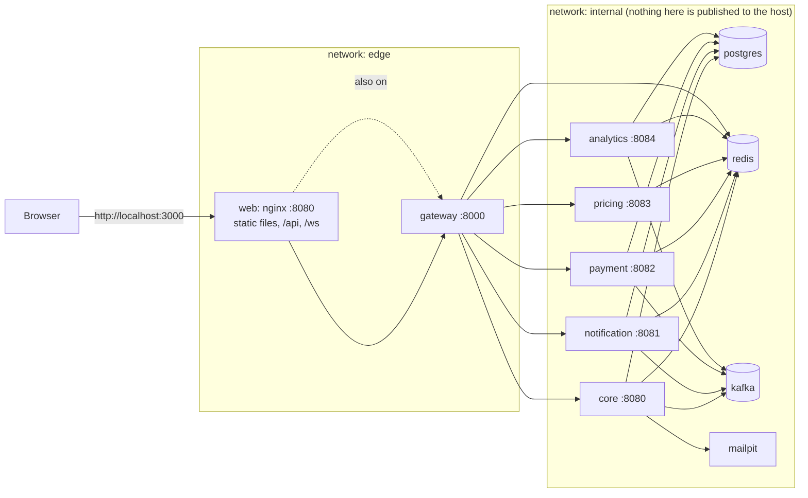

# Phase 9 review: Docker

New to Docker? Read [docker-concepts.md](docker-concepts.md) first. This is the review: what changed, why, how to run and check it, what can go wrong, and how to defend it in an interview.

## 1. What changed, step by step

| Step | What we built | Where |
|---|---|---|
| 9.1 Dockerfile for Spring services | One **multi-stage** Dockerfile for all six services (selected with `--build-arg MODULE`). JDK + Maven stage compiles; a second stage splits the jar into **layers**; the final stage is a JRE on Alpine with a **non-root user**, container-aware JVM flags and a clean-shutdown entrypoint. `.dockerignore` keeps secrets and build output out | `backend/Dockerfile`, `backend/.dockerignore` |
| 9.2 Dockerfile for React | Node stage builds the site; the final image is **nginx-unprivileged** (non-root) with the static files. nginx serves the single-page app (history fallback, immutable asset caching, no-cache index), and proxies `/api` and `/ws` (WebSocket upgrade) to the gateway | `frontend/ridex-web/Dockerfile`, `nginx.conf`, `.dockerignore` |
| 9.3 Full Compose system | Eleven containers: web, gateway, core, notification, payment, pricing, analytics, postgres, redis, kafka, mailpit. **Two networks**, **health checks with `depends_on: service_healthy`**, **secrets as files**, environment variables for everything else, volumes, memory limits, hardening, log rotation. Kafka now has two listeners | `infrastructure/docker-compose/docker-compose.yml`, `.env.example` |
| 9.4 This review | `docker compose up` runs everything; a smoke-test script proves it; policy tests keep it that way | `scripts/docker-init.ps1`, `scripts/docker-smoke.ps1`, `ContainerPolicyTest` |

Also: the **gateway learned to trust a proxy of ours** (`ClientAddress`, `ridex.gateway.trusted-proxies`) so the real client address survives nginx; otherwise everybody would share one rate-limit bucket (see section 5).

## 2. Architecture


`gateway` is attached to both networks; `web` only to `edge`; the database, cache and broker only to `internal`.

### Start-up order (from the health checks)
```
postgres, redis, kafka  (healthy)
   └─► core, notification, payment, pricing, analytics  (healthy)
          └─► gateway (needs core healthy)
                 └─► web (needs gateway healthy)
```
A full cold start takes about two minutes on this laptop; most of it is six Spring Boot applications starting.

## 3. Decisions and reasons

| Decision | Reason |
|---|---|
| One Dockerfile with `MODULE` argument | Six near-identical files would drift; the build cache is shared (the Maven stage runs once for all services) |
| Build with Maven **inside** Docker | Reproducible: the image does not depend on what happens to be in your `target` folder. Cost: slower first build (cache mount makes later ones fast) |
| Tests skipped inside the image build | They need Docker themselves (Testcontainers) and run in the test pipeline (next phase), not in the image |
| JRE on Alpine, pinned versions | Smaller, fewer packages to attack, reproducible |
| Layered jars | Code changes rebuild 98 kB instead of 65 MB |
| `MaxRAMPercentage=70` + `mem_limit` per container | The Docker VM here has 4 GB. Without limits one service can take all of it; with limits the JVM sizes itself and the kernel only kills the offender |
| Two networks | The website container cannot reach the database, even if compromised |
| Publish only on 127.0.0.1, and only web, gateway and dev tools | Other machines on the network cannot reach anything; the five services are reachable only through the gateway |
| Secrets as files (configtree), not environment variables | Not visible in `docker inspect` or the process environment; the Spring properties are unchanged |
| `service_healthy` everywhere | "Started" is not "ready" |
| `read_only`, `cap_drop: ALL`, `no-new-privileges` | Cheap, and removes whole classes of post-compromise behaviour. The apps need only `/tmp` (tmpfs) and their data volume |
| Kafka with INTERNAL and EXTERNAL listeners | Containers use `kafka:29092`, your IDE/scripts keep using `localhost:9092`: both workflows keep working |
| Keep the old workflow possible | `docker compose up -d postgres redis kafka mailpit` starts only the infrastructure, exactly as before, for running Java from `start-services.ps1` |
| `unless-stopped` restart | A crash is retried, a deliberate `docker stop` is respected |
| nginx also in front of the **WebSocket** | Live updates must work in the packaged system, not only in dev |

## 4. How to run it

```powershell
cd F:\RideX\ridex
.\scripts\docker-init.ps1                 # once: creates infrastructure\docker-compose\secrets\ (git-ignored)
cd infrastructure\docker-compose
docker compose up -d --build              # first build: several minutes; later builds: seconds to a minute
docker compose ps                         # everything should say "healthy" after about two minutes
```

Open **http://localhost:3000**. Mail sent by the app (verification codes, password reset) is caught at **http://localhost:8025**.

To create the first admin, put `ADMIN_EMAIL` and `ADMIN_PASSWORD` in `infrastructure/docker-compose/.env` (git-ignored) *before* the first start of the core.

Check it automatically:
```powershell
cd F:\RideX\ridex
.\scripts\docker-smoke.ps1                # 41 checks through nginx; creates and cancels one test ride
.\scripts\docker-smoke.ps1 -Resilience    # also stops the pricing container and shows the system coping
```

**One mode at a time.** The packaged system uses the same names, volumes and ports as the "scripts" workflow (`start-services.ps1`). Do not run both: stop one before starting the other (`docker compose stop`, or `.\scripts\stop-services.ps1`). The data (volumes) is shared, so you keep your users and rides when you switch.

**Frontend development against the containers:** `docker compose up -d` then `npm run dev` works too: the gateway is published on `127.0.0.1:8000`, which is what the Vite proxy targets.

### Troubleshooting
| Symptom | Cause and fix |
|---|---|
| `secret ... file ... not found` | Run `.\scripts\docker-init.ps1` |
| A container is killed, `docker inspect` says `OOMKilled` | Not enough memory. Docker Desktop's budget (Settings → Resources, or `memory=` in `%UserProfile%\.wslconfig`) is too small. Raise it to 6 GB if the machine allows, or stop what you do not need (`docker compose stop analytics notification`) |
| `web` keeps restarting, log says `host not found in upstream "gateway"` | The gateway is not running. `docker compose up -d gateway` first (compose normally orders this) |
| First build is very slow | It downloads Maven and npm dependencies once. Later builds use the cache |
| Port 3000/8000 already in use | Another program, or the scripts workflow, is using it. Stop it |
| Changed Java code but nothing changed | Rebuild: `docker compose up -d --build core` |
| You want to start from nothing | `docker compose down -v` **deletes the databases, uploads and the token key**. Not undoable |

## 5. Things that went wrong on the way (and what they teach)

1. **The web health check failed although nginx was running.** BusyBox `wget` resolves `localhost` to the IPv6 address `::1`; nginx listened on IPv4 only. Lesson: a failing health check can be the *check* that is wrong. Use `127.0.0.1`.
2. **Everyone behind nginx would have been one client.** The gateway sees nginx's address on every connection, so the per-client rate limit became a global one. Fix: nginx writes the real client in `X-Forwarded-For` (overwriting what the client sent), and the gateway honours that header only for connections from its trusted proxy ranges. Tests cover forged headers and multi-hop chains.
3. **Memory.** The first limits (320 MB) left the notification and payment services at 91 to 95% of their limit. Raised to 384 MB. Look at `docker stats`, then set limits with some headroom.
4. **Stopping a container gives `504`, not `503`.** A stopped container's address does not answer at all, so the gateway's connect timeout (2 s) fires. A refused connection would be `503`. Both are "the service is unavailable"; the smoke test accepts either.
5. **Windows PowerShell mangles quotes** in arguments passed to `curl.exe`; the smoke script passes request bodies through a temporary file.

## 6. Measured on this machine

| | |
|---|---|
| Image sizes | web **86 MB**; pricing 410 MB; gateway 402 MB; analytics 414 MB; notification 465 MB; payment 469 MB; core 478 MB. (The Maven build image alone is 814 MB and none of it ships) |
| Layers of an image | JRE base, libraries **64.6 MB**, our code **98 kB** |
| Build | first build of everything: about 4 minutes; rebuilding all after a change: about 1.5 minutes |
| Cold start of the whole stack | about 2 minutes to all healthy |
| Memory in use (whole stack) | core 386 MB, payment 322 MB, notification 312 MB, analytics 239 MB, pricing 206 MB, gateway 190 MB, kafka 295 MB, postgres 101 MB, the rest under 15 MB each: about **2.1 GB** in a 4 GB VM |

## 7. How it is proven

| Check | How | Where |
|---|---|---|
| The images build | `docker compose build` | |
| The whole system works | 41 checks through nginx on port 3000: health, SPA fallback, caching and security headers, login, every service through the gateway, a ride request (core calls pricing with the secret service token), WebSocket handshake (101) | `scripts/docker-smoke.ps1` |
| Hardening is real | Runs as uid 10001 / 101, read-only filesystem rejects writes, no password in the container environment, secrets mounted as files, ports 8080 to 8084 closed on the host | smoke script, section 5 |
| Resilience in containers | Stop pricing: clean gateway error, the rest works; start it: fares work again, nothing was restarted | `-Resilience` |
| State survives | Restarting the core keeps the same login token valid (signing key is on a volume) | manual check, done |
| The rules cannot be broken by accident | 17 tests read the Dockerfiles and compose file: multi-stage, pinned images, non-root, no build tools in the runtime, no secret in an image or compose file, hardening on every app container, health checks, `service_healthy`, network segmentation, ports bound to localhost, services not published, secrets only where needed, secrets git-ignored. Changing `USER ridex` to `root`, or publishing a port to all interfaces, was shown to fail them | `ContainerPolicyTest` |
| The gateway behind a proxy | Real client address honoured only from trusted proxies; forged chains rejected; separate rate-limit bucket per real client | `GatewayBehindProxyTest` |

### Final results

Whole backend build (`cd backend; .\mvnw.cmd install`, run with the containers stopped because the tests start their own PostgreSQL, Redis and Kafka):

| Module | Tests |
|---|---|
| platform | 23 |
| core | 424 |
| notification-service | 21 |
| payment-service | 19 |
| pricing-service | 19 |
| analytics-service | 7 |
| api-gateway | 37 |
| architecture-tests (boundaries, databases, **containers**) | 37 |
| **Backend total** | **587** |

Plus the 41 smoke checks against the running containers (`scripts/docker-smoke.ps1`). The frontend code did not change in this phase (only its packaging), and its 76 tests, type check, lint and build were last run in Phase 8; the image build runs `tsc` and the production build again.

## 8. Interview questions and answers

**1. What is the difference between an image and a container?**
An image is a read-only, layered template (files plus the command to run). A container is a running instance of it with a thin writable layer. You can start many containers from one image and delete them freely; anything that must persist goes in a volume.

**2. Container versus virtual machine?**
A VM runs a whole operating system with its own kernel. A container shares the host's kernel and isolates only processes, files, network and users. So containers are much smaller and start in seconds, with weaker isolation than a VM.

**3. What is a multi-stage build and why use it?**
Several `FROM` stages in one Dockerfile: a heavy build stage (JDK, Maven) compiles, and only the result is copied into a small runtime stage. The final image has no compiler or source code: smaller, faster to deploy, and a smaller attack surface.

**4. How do layers and the build cache work, and how do you order a Dockerfile?**
Each instruction creates a cached layer; if it and everything above it are unchanged, Docker reuses it. So: things that change rarely first (dependencies), things that change often last (code). Spring Boot's layered jars apply the same idea to the application: our own code was 98 kB of a 410 MB image.

**5. Why run as a non-root user?**
If the application is compromised, the attacker gets the process's rights. As root in a container that includes capabilities and write access to everything; as an unprivileged user with a read-only filesystem and dropped capabilities, very little. It is the cheapest hardening there is.

**6. `depends_on` versus health checks?**
`depends_on` alone orders the *start* of containers, not their readiness. With `condition: service_healthy` Compose waits until the dependency's health check passes. Even so, it only orders startup; services must still handle a dependency going away later.

**7. How do containers find each other?**
On a user-defined network Docker runs a DNS server: the service name (`postgres`, `gateway`) resolves to the container's current address. That is why URLs in the configuration use names, never addresses.

**8. Environment variables or secrets for passwords?**
Environment variables are visible in `docker inspect`, inherited by child processes and often logged in diagnostics. A secret is delivered as a file mounted only into the containers that need it. We use files for the database password and the service token, and Spring reads them as configuration. Orchestrators (Kubernetes, Swarm) have the same concept with stronger storage.

**9. Why does Kafka need two listeners here?**
A broker tells each client the address to use for further connections. Containers must be told `kafka:29092`; programs on the host must be told `localhost:9092`. One advertised address would break one of the two.

**10. What happens when a container exceeds its memory limit?**
The kernel kills it (OOM kill) and Docker restarts it if the restart policy says so. For Java we size the heap as a percentage of the container limit (`MaxRAMPercentage`) so the JVM stays below it, and leave room for non-heap memory (metaspace, threads).

**11. Why is the database not published to the network?**
Anything published can be attacked. Only the website and gateway are published, bound to `127.0.0.1`, and the database sits on a network the website container is not on. For development we do publish Postgres to localhost only, with a note to remove it elsewhere.

**12. Does `docker compose up` replace Kubernetes?**
No. Compose runs a set of containers on **one machine**. Kubernetes runs them across many machines, with scaling, rolling updates, self-healing and service discovery. Compose files are an excellent way to understand the pieces (images, networks, volumes, health checks, secrets), which map almost one-to-one onto Kubernetes objects: the next steps of the roadmap.

**13. How do you update one service without touching the others?**
`docker compose up -d --build core` rebuilds that image (only the changed layer) and replaces just that container; the others keep running. Data lives in volumes, so nothing is lost.

## 9. What is still simplified

* One machine, one database server, one Kafka broker: no replication, no failover.
* Images are tagged `dev` and live only on this machine; there is no registry and no automated build. Both arrive with CI/CD in the next phase.
* Secrets are files on the host disk. A production system uses a secret manager.
* Everything is plain HTTP on localhost; TLS belongs on the public entry point of a real deployment.
* No log aggregation or metrics yet (observability phase). Logs are per container (`docker compose logs`).
* The test suite is not run inside the image build; the pipeline will build, test and scan images.
