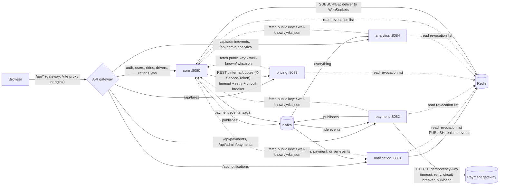

# RideX service map

The one-page picture of Phase 7. For the reasons behind it read [microservices-concepts.md](microservices-concepts.md).

## 1. The services

| Service | Port | Database | Job | Talks to |
|---|---|---|---|---|
| **core** (`ridex-app`) | 8080 | `ridex_db` | Auth, users, riders, drivers, rides, matching, ratings, WebSockets. Issues the tokens | publishes `ride-events` and `driver-events`; calls **pricing** (REST); consumes `payment-events` (saga) |
| **notification-service** | 8081 | `notification_db` | Turns events into stored and live notifications | consumes all three topics; pushes to the core's WebSockets through Redis |
| **payment-service** | 8082 | `payment_db` | Charges riders through the payment gateway, safely | consumes `ride-events`; publishes `payment-events`; calls the **gateway** (HTTP, protected) |
| **pricing-service** | 8083 | none (stateless) | The fare formula | answers the core (and riders) over REST |
| **analytics-service** | 8084 | `analytics_db` | Audit log, daily counts, dead letters, consumer lag | consumes every topic and every `.DLT` topic |
| **platform** (library) | none | none | Event contracts, outbox, idempotent consumers, JWT validation, error shape. **No business logic** | linked into every service |

Infrastructure (Docker): PostgreSQL 17 (one server, four databases), Redis 7, Kafka (KRaft, one broker).

## 2. Who talks to whom



Solid lines are work; dotted lines are the token machinery. Every service verifies tokens **locally** with the core's public key: the core is not called per request.

## 3. Kafka topics and consumer groups

| Topic | Key | Published by | Event types |
|---|---|---|---|
| `ride-events` | ride id | core | `ride.status-changed` |
| `payment-events` | ride id | payment | `payment.succeeded`, `payment.failed` |
| `driver-events` | driver user id | core | `driver.application-reviewed` |
| `<topic>.DLT` | same | any consumer's error handler | messages that failed for good |

| Group | Service | Reads | Does |
|---|---|---|---|
| `notifications` | notification | ride, payment, driver | stores and pushes notifications |
| `payments` | payment | ride | charges the rider when a ride completes |
| `ride-payment-saga` | core | payment | blocks / unblocks a rider (compensation) |
| `analytics` | analytics | ride, payment | daily counts |
| `audit` | analytics | ride, payment, driver | append-only log |
| `dead-letters` | analytics | all `.DLT` topics | parks failures for admins |

## 4. Who owns which table

| Database | Tables |
|---|---|
| `ridex_db` (core) | users, rider/driver profiles, vehicles, documents, rides, ride history, ratings, driver availability, `rider_payment_blocks`, `outbox_events`, `processed_events`, app info. *Legacy, no longer used: `notifications`, `payments`, `mock_gateway_charges`, `event_audit_log`, `ride_status_counts_daily`, `dead_letter_events` (see [phase-7-contract.sql](sql/phase-7-contract.sql))* |
| `notification_db` | `notifications`, `processed_events`, `outbox_events` (unused) |
| `payment_db` | `payments`, `mock_gateway_charges`, `outbox_events`, `processed_events` |
| `analytics_db` | `event_audit_log`, `ride_status_counts_daily`, `payment_outcomes_daily`, `dead_letter_events`, `processed_events` |

## 5. Endpoint ownership (what the gateway routes)

| Path | Service |
|---|---|
| `/api/auth/**`, `/api/users/**`, `/api/riders/**`, `/api/drivers/**`, `/api/rides/**`, `/api/admin/{users,drivers,vehicles,rides,stats,outbox}`, `/ws`, `/.well-known/jwks.json` | core |
| `/api/notifications/**` | notification |
| `/api/payments/**`, `/api/admin/payments/**` | payment |
| `/api/fares/**` | pricing |
| `/api/admin/events/**`, `/api/admin/analytics/**` | analytics |

In development the Vite proxy (`vite.config.ts`) does this routing. In production a reverse proxy does; a minimal nginx example:

```nginx
location /api/notifications { proxy_pass http://notification:8081; }
location /api/payments      { proxy_pass http://payment:8082; }
location /api/admin/payments{ proxy_pass http://payment:8082; }
location /api/fares         { proxy_pass http://pricing:8083; }
location /api/admin/events  { proxy_pass http://analytics:8084; }
location /api/admin/analytics { proxy_pass http://analytics:8084; }
location /ws                { proxy_pass http://core:8080; proxy_http_version 1.1;
                              proxy_set_header Upgrade $http_upgrade; proxy_set_header Connection "upgrade"; }
location /                  { proxy_pass http://core:8080; }
```

## 6. What happens when a service is down

| Down | What still works | What does not | After it returns |
|---|---|---|---|
| **notification** | Rides, payments, everything else | No notifications arrive | It reads the events it missed, in order, and creates the notifications |
| **payment** | Booking and completing rides | Rides complete but nobody is charged yet; the payment card says "processing" | Reads the missed `ride completed` events and charges each rider once |
| **pricing** | Everything already in progress; rides can still be accepted, completed, paid | **Booking a new ride**: HTTP 503 with `Retry-After`. After a few failures the circuit opens and answers instantly | The circuit goes half-open after 10 s, tries a call, closes |
| **analytics** | Everything | Admin event pages | Catches up from its saved position |
| **Kafka** | Auth, rides (state changes are saved with outbox rows) | Events pile up in the **outbox** instead of being lost | The relay publishes the backlog in order |
| **Redis** | Parts that do not use it | Matching, rate limiting, the revocation list and live WebSocket fan-out depend on it (see [phase-4-review.md](phase-4-review.md) for each one's failure rule) | Resumes |
| **payment gateway** | Everything but charging | Payments wait as `PENDING` and are retried with the same idempotency key; after repeated outages they `FAIL` and the saga blocks the rider | Pending payments complete automatically |
| **core** | Other services keep verifying tokens with the public key they cached (a few minutes) | Login, rides, new tokens, WebSockets. When the cached key expires and cannot be refreshed, services refuse tokens too | Everything resumes |

## 7. Ports and start order

1. Docker: `docker compose up -d` (PostgreSQL, Redis, Kafka).
2. **core** first: it creates the signing key and publishes the public key the others fetch.
3. Then pricing, notification, payment, analytics in any order. (A service started before the core simply retries its key fetch on the first request.)
4. `npm run dev` in `frontend/ridex-web`.

Scripts: `scripts/build-all.ps1`, `scripts/start-services.ps1 [-Only core,pricing]`, `scripts/status.ps1`, `scripts/stop-services.ps1`.

## 8. Environment variables

| Variable | Used by | Meaning |
|---|---|---|
| `DB_PASSWORD` | all with a database | password of the `ridex` PostgreSQL user |
| `SERVICE_TOKEN` | core, pricing | shared secret for internal calls (generated by `start-services.ps1` into the git-ignored `data/`) |
| `ADMIN_EMAIL`, `ADMIN_PASSWORD` | core | creates the first admin if none exists |
| `JWKS_URI` | services | where to fetch the public key (default `http://localhost:8080/.well-known/jwks.json`) |
| `PRICING_URL` | core | where the pricing service is (default `http://localhost:8083`) |
| `KAFKA_BOOTSTRAP`, `REDIS_HOST`, `REDIS_PORT` | all | infrastructure addresses |
| `LEGACY_DB_URL` | notification, payment, analytics | JDBC URL of the core database, for the one-time copy of old rows (leave empty to skip) |
